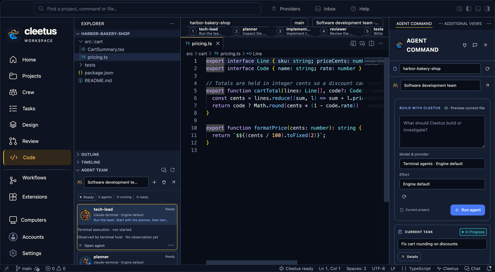

# Cleetus

**Herding models. Shipping code.**

Cleetus is an agentic development environment: a Code - OSS editor with your own Claude Code, Codex and supported ACP agents, reviewable tasks, workflows and a source-linked design studio built in.

This is the public download and documentation home for Cleetus. Development source is maintained separately; you don't need source access to install a release.

**[Find Cleetus releases](https://github.com/SnowBiz/cleetus-releases/releases) · [Install and update](docs/INSTALL.md) · [Guides](docs/README.md) · [cleetus.dev](https://cleetus.dev)**

**Available now:** [Cleetus IDE 0.2.0](https://github.com/SnowBiz/cleetus-releases/releases/tag/ide-v0.2.0-macos-arm64) for macOS Apple Silicon and the independent [VS Code extension 1.12.1](https://github.com/SnowBiz/cleetus-releases/releases/tag/v1.12.1). The Mac installer is signed and notarized; both releases include checksums.

| Product | Choose an accepted build |
| --- | --- |
| **Cleetus IDE** | In the [public releases listing](https://github.com/SnowBiz/cleetus-releases/releases), choose the latest stable macOS Apple Silicon IDE whose notes include the current native Claude Code connection. Download its DMG and `SHA256SUMS` from that same release. The complete editor replaces VS Code. |
| **Cleetus VS Code extension** | Choose the latest stable universal VSIX whose notes include current native Claude Code setup, with matching `SHA256SUMS` in the [release listing](https://github.com/SnowBiz/cleetus-releases/releases). Maintained and released independently for ordinary VS Code. |

Older SDK subscription-flow builds are retired from the recommended install
path. Use the current releases above for native Claude Code setup.

## Build with a crew

Give Agent Command a goal, or a team of Claude and Codex agents a shared one. Teams run as pipelines, in parallel or under a supervisor, with fenced handoffs and delivery limits. Nine original prebuilt teams cover delivery, UI design, design extraction, review, debugging, security, refactoring, documentation and a lean pair. Tasks carry acceptance criteria and finish only when you approve the result.

[Agent Command](docs/GUIDE.md) · [Agent teams](docs/TEAMS.md) · [Tasks](docs/TASKS.md) · [Workflows](docs/WORKFLOWS.md) · [Review & Ship](docs/REVIEW.md)

Builds with **Cleetus: Connect coding agents** can also connect your independently installed Copilot, Kiro V3, Gemini CLI, OpenCode or a custom ACP stdio agent. Follow [coding-agent connections](docs/CODING_AGENTS.md) for native sign-in, launch approvals and capability limits; check feature availability in your installed build.

Pair two teams on the same private IPv4 subnet with [opt-in LAN collaboration](docs/COLLABORATION.md): pinned TLS 1.3, a one-use invitation and matching eight-digit codes. Both people approve pairing, and every outgoing proposal and incoming import needs local approval. Accepted tasks remain pending; messages go to a separate approved inbox.

## Design with a studio

Extract tokens, components, pages, assets and rules from a codebase into your repository. Render real components with controlled stories, review pages at device widths, refine with agents, and link repository systems into a product library.

[Cleetus Design](docs/DESIGN.md) · [Live previews](docs/ADAPTERS.md) · [Product libraries](docs/LIBRARIES.md)

## Connect your work

Use GitHub Issues, Jira or a custom REST tracker; let authorized agents take fenced custom-tracker claims; and read PR check and review evidence bound to the head commit. Assign MCP servers per agent and connect local, container and hosted developer tools.

[Work tracking](docs/WORK_TRACKING.md) · [Tools, MCP and approvals](docs/TOOLS.md) · [Local service](docs/SERVICE.md) · [Memory and rules](docs/MEMORY.md)

## Your Cleetus account and saved settings

The Account view uses your system browser for Cleetus sign-in. It does
not sign in to Claude Code, Codex or ACP providers or supply their model access.

**Scout · Free** keeps all nine original team templates, custom teams and existing
tools available without a Cleetus account. **Wrangler · Pro** adds Studio
refinement, Release readiness and two read-only evidence tools. **Foreman · Team**
adds Cross-project review. Premium resources need fresh verified server grants;
cached profile details and local switches cannot grant access. Existing free
features, Apache rights and already-granted preview rights remain unchanged.

Signed-in Scout accounts can save nonsecret startup-view, motion and layout
preferences and feature opt-outs. Conflicting revisions require review before
saving again. Provider credentials, environment variables, project paths,
transcripts and team history are excluded from this sync.

[Cleetus accounts](docs/ACCOUNTS.md) · [Membership and saved settings](docs/MEMBERSHIP.md)

## How it works

[Architecture](docs/ARCHITECTURE.md) · [Security model](docs/SECURITY_MODEL.md) · [Plugins and hooks](docs/PLUGINS.md)

## Install

**Cleetus IDE:** choose the latest stable Apple Silicon IDE in the [public releases listing](https://github.com/SnowBiz/cleetus-releases/releases) whose notes describe the current native Claude Code connection. Download its DMG and `SHA256SUMS` from the same release, verify the checksum, open the DMG and drag **Cleetus.app** to **Applications**. Launch Cleetus and open your project. The editor is included.

**VS Code extension:** choose the latest stable universal VSIX in the [release listing](https://github.com/SnowBiz/cleetus-releases/releases), choose notes that include current native Claude Code setup and verify its `SHA256SUMS` entry, then choose **Extensions → Install from VSIX…** in VS Code. Its release and update channel is independent from the IDE.

Native Claude Code uses your own installed CLI and its native sign-in; no Claude
SDK package is required. Codex and supported ACP agents use their own documented
executables. The separate SDK runtime is only for optional Claude API/cloud
access with an API key or supported cloud credentials. Consumer Claude
subscription sign-in through the SDK is not offered. Use Node.js 22+ and npm
where your selected runtime requires them. The [installation guide](docs/INSTALL.md)
covers engine setup and the optional SDK runtime installer.

Update checks offer an explicit download and install choice; nothing installs silently. Account access, model usage, native toolchains and third-party charges remain separate.

## Licensing and availability

Apache-licensed Cleetus extension portions keep their accompanying license and notices. Covered Cleetus IDE builds identify their proprietary portions under the Preview License, which permits personal and commercial use without a software license fee; future editions or services may charge prospectively. Existing Apache rights and already-granted preview builds aren't retroactively relicensed or charged.

[License details](docs/LICENSES.md) · [Apache-2.0](docs/licenses/Apache-2.0.txt) · [IDE preview terms](docs/licenses/IDE-PREVIEW-LICENSE.txt)

The native captures show the earlier Cleetus IDE 0.1.0 interface with an isolated CleetusGuide01 sample project: ready, unstarted members, a pending task, a saved workflow with no runs, a real local Git diff and live source previews. No providers were started for them, and they don't demonstrate live account work, customer extraction or a physical two-computer LAN session. Cleetus is independent of Anthropic and OpenAI and uses your own provider accounts.
