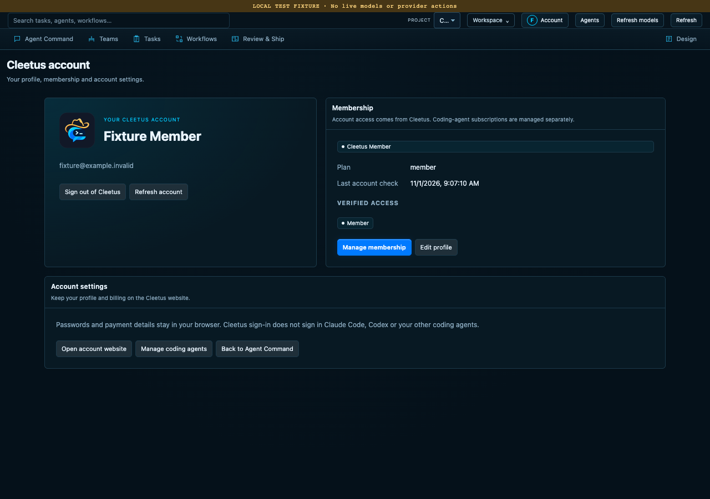
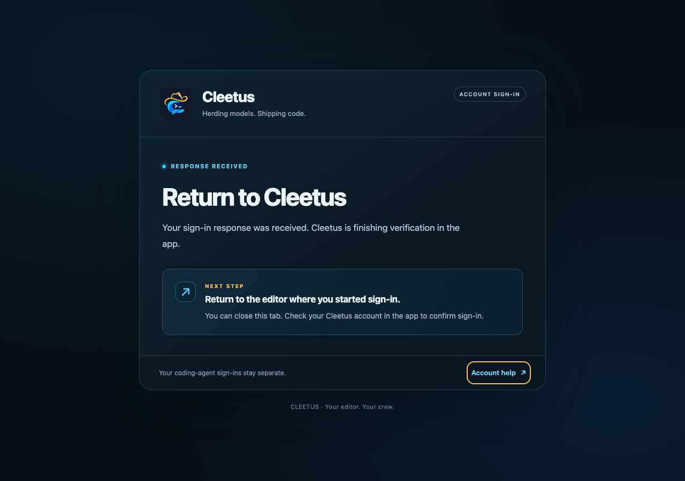

# Your Cleetus account

Cleetus account sign-in connects the IDE to your Cleetus profile and membership.
It is separate from Claude Code, Codex and other coding-agent authentication.
Signing in to Cleetus does not provide a model subscription or an API key.

The image uses a clearly labeled local test profile, not a real billing account.

## Sign in

1. Choose **Account** in Studio or the native title bar. In VS Code, run
   **Cleetus: Account and Membership** from the command palette.
2. Choose **Sign in to Cleetus**. Your system browser opens the hosted Cleetus
   sign-in page. Use your password manager there; credentials never go into chat.
3. Return to Cleetus after the browser confirms completion. The account screen
   shows your profile, membership and the entitlements verified by the service.

The desktop flow uses authorization code with PKCE and a short-lived listener
on `http://localhost:47615/callback`. If another Cleetus window is signing in,
finish or cancel that attempt first. **Cancel sign-in** closes the local attempt;
a delayed browser callback cannot sign you back in after cancellation or logout.
The IDE does not use an embedded login browser or collect your password.

## Membership and features

The production account service and public membership guide are deployed. The
service provides **Scout · Free**, **Wrangler · Pro** and **Foreman · Team**
membership metadata and saved preferences. A native development host has passed
Scout sign-in and a production preference save/reload roundtrip. Paid grants and
subscription purchases have not been checked with a live paid account. The IDE
0.2.0 and extension 1.12.1 client additions are published. Signed installer
artifact acceptance passed; installed-app credential persistence remains a
separate live acceptance item.

All nine existing prebuilt teams, custom teams and existing tools remain free
local functionality. Wrangler adds two curated teams and two read-only
membership tools; Foreman adds Cross-project review. See
[Membership and saved settings](MEMBERSHIP.md) for the resource catalog, legacy
paid membership mapping and checkout limits.

**Manage membership** opens your hosted account page for subscriptions, receipts
and billing changes. Choose **Refresh account** after changing membership.
Cleetus obtains its tier and feature catalog from the account service. Tier cards
and locked catalog entries display that result; a renderer preference or a
provider's advertised model list cannot grant membership features.

A verified entitlement requires a current, validated sign-in and a fresh account
response less than five minutes old. Premium access also requires the tier's
server grant, a server-enabled feature and no user opt-out; subscription access
requires an unexpired live paid period. Unknown or test subscriptions do not
grant paid production access. Complimentary access requires an explicit server
grant. Core checks new premium requests and each premium Core/MCP tool call.
Offline or unknown verification denies new premium access, while a cached
profile can remain visible as last known. Existing running work is not
automatically stopped when membership changes.

## Saved Cleetus settings

Signed-in accounts, including Scout, can load and save a small set of nonsecret
cloud preferences. In native Studio, open **Account → Saved Cleetus settings**.
In VS Code, run **Cleetus: Account and Membership** and choose **Saved Cleetus
settings**.

The version 1 record contains only the preferred startup view (Agent Command,
Teams or Design), reduced motion, compact layout and optional membership-feature
opt-outs. It does not sync provider credentials, paths, environment variables,
tool configuration, projects or project data. Feature switches cannot upgrade
your membership or enable a feature disabled by the server.

Each draft is bound to the account session and revision that loaded it. Signing
out, changing accounts or refreshing account verification can invalidate a
draft, even if the displayed name and email are unchanged. Reload before saving
again; an old draft cannot be reassigned to the newly signed-in account.

If another installation saved first, explicitly reload and review the latest
preferences before saving again. Cleetus does not silently overwrite or retry
the conflict. Studio provides
**Reload saved preferences**; in VS Code, reopen **Saved Cleetus settings** to
load the current revision. See the [settings reference](MEMBERSHIP.md#saved-cleetus-settings)
for the exact fields and save controls.

A successful save applies feature opt-outs immediately. To verify newly enabled
membership features, choose **Refresh account**, then reload preferences before
making further changes.

## Credentials and sign-out

Refresh credentials stay in the host's secure credential store: SecretStorage in
VS Code and the native editor's OS-backed credential storage. Access and identity
tokens stay in the host process, never the renderer, saved chat, project files,
phone snapshots or public logs. Supported local desktop hosts also require Cleetus’s credential transaction
capability. Remote extension hosts and hosts without that capability cannot sign
in; their existing local/free project features remain available. The current
transaction adapter requires private POSIX filesystem ownership and is not
enabled for Windows hosts.

**Sign out** clears local credentials and verified features. It does not sign you
out of a coding-agent provider or delete your project, team history or Design
library. Provider authentication remains in that provider's own supported flow.

## Troubleshooting

- **Browser did not open:** check the host's external-browser support, cancel the
  attempt and retry. No tokens or callback URLs need to be pasted into Cleetus.
- **Local sign-in port is busy:** finish the other sign-in or close its attempt.
  The IDE uses the registered callback rather than guessing an unregistered port.
- **Account service is unreachable:** the screen shows offline or unverified
  status; retry **Refresh account** when connected.
- **Membership changed but features have not:** refresh after checkout. If your
  session expired, sign in again through the system browser.

[Install Cleetus](INSTALL.md) · [Coding-agent connections](CODING_AGENTS.md)

## Storage upgrades and interruption

Current account storage uses versioned immutable encrypted records. A small
nonsecret record identifies the current credential generation; it contains no
tokens or profile details. Upgrading from an unreleased account prototype asks
you to sign in again and leaves its older credential keys unused.

Cancellation before publication retains the previously committed account. Once
the new account has been published, cancellation cannot pretend it was undone.
Sign-out removes local account authority before credential cleanup. An uncertain
refresh attempt requires a new sign-in rather than replaying a potentially rotated
refresh credential. Missing or delayed credential records grant no access; the
screen reports storage unavailability until the credential store can be read.
Owner review can be necessary after damaged storage or an unconfirmed recovery
lock. Do not delete authority records to bypass that state.

## Browser return page

After browser sign-in, the return page matches Cleetus’s dark styling and logo.
It confirms that the response reached the app; finish checking your account and
membership in Cleetus. You can close the browser tab. One-time callback parameters
are removed from the address bar, and the page loads no external assets or trackers.

_Layout shown with a local test callback. Browser receipt is separate from the
app’s completed identity verification._
