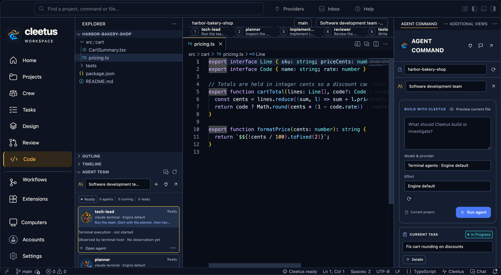

# Live previews

_Read this guide on [cleetus.dev](https://cleetus.dev/docs/previews/)._

Cleetus previews render the implementation your product ships, not a drawing of it. Adapters translate the shared design-library contract into each platform's runtime: a browser sandbox for web source, and real Xcode builds in Simulator for iOS and watchOS.

## Preview the file you're editing

Run **Cleetus: Preview Current File**, or choose **Preview current file** in Agent Command, for a registered page or component.

- Switch between **Fit canvas**, **Desktop**, **Tablet** and **Phone**.
- **Save** the source to rebuild the preview. **Reload** refreshes it and **Source** jumps to the implementation.
- Buttons and forms run the real registered source against controlled fixture data.
- Build failures stay visible instead of falling back to an older render.
- **Design Studio ↗** opens the same item in the full Design viewer.

Live source watching runs in its own helper process, so a stalled operating-system file-notification service can't freeze the preview host when you stop a preview.

## Web

Register real component and page source with controlled fixtures, props, states and variants. A useful story is a composed interface block in realistic states, including empty, loading and error where they matter.

The web adapter builds that source into an interactive browser sandbox. Use sample fixtures, never live account secrets. You don't need a PNG for every change; optional snapshots are there for comparison and export. Existing Storybook targets can sit alongside.

Install project dependencies yourself. Discovery alone can't invent authenticated data, and Cleetus doesn't start your project's dev server or run project scripts in Node to generate components.

## iOS and watchOS

Native previews use real Debug story hosts and Xcode builds through the Apple adapter, rendered in Simulator or Apple Device Hub. There's no UIKit or SwiftUI emulation in a web view.

1. Prepare a target and scheme with story entry points, using a dedicated preview configuration and fixed launch arguments.
2. Install Xcode and the Simulator runtimes you need.
3. Choose **Open native preview**. **Build log** shows the actual build output.

Keep normal app startup and Release behaviour intact. A discovered Swift file isn't proof that a story compiled or rendered, and native builds execute your project's code with your privileges.

## Platform coverage

Keep web breakpoints, iOS, watchOS and future platforms explicit in each system and contract. Share visual intent and token semantics while keeping each platform's own implementation. Android source discovery works today; native Android rendering doesn't yet.

## Debugging alongside previews

The IDE ships the pinned open-source JavaScript and Node debugger from the Code - OSS release. Set a breakpoint, choose a Node launch configuration in **Run and Debug**, and inspect variables, stacks and expressions while the preview runs. Other languages need their own debug extensions from Open VSX.

[Cleetus Design](DESIGN.md) · [Agent Command](GUIDE.md)
