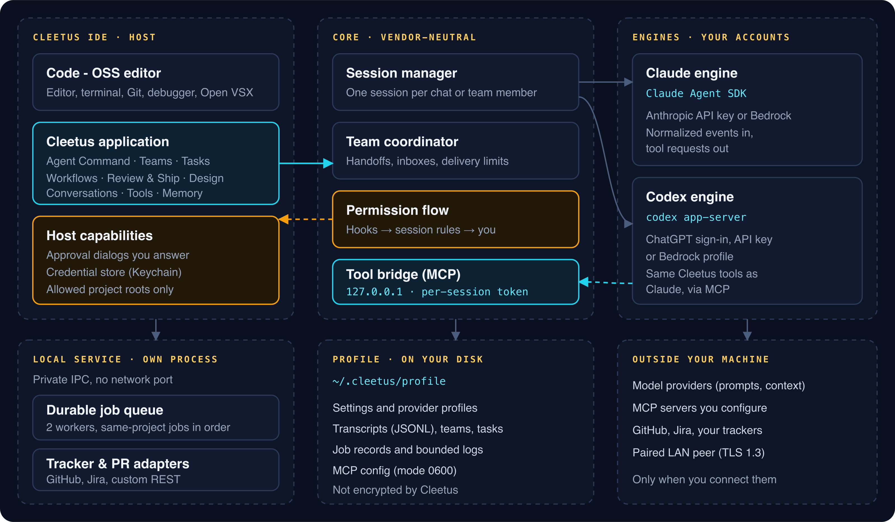

# Architecture

_Read this guide on [cleetus.dev](https://cleetus.dev/docs/architecture/)._

Cleetus is a small, vendor-neutral core with adapters on each side: hosts above it (the IDE), engines below it (Claude and Codex), and a local service beside it for background work. This page follows a request from the chat to an engine and back.

## The pieces

| Piece                  | Responsibility                                                                                                                                             |
| ---------------------- | ---------------------------------------------------------------------------------------------------------------------------------------------------------- |
| **Host**               | The Code - OSS editor and its windows. Supplies the editor, approval dialogs, the credential store and the set of project roots Cleetus may touch.         |
| **Shared application** | The Cleetus screens (Agent Command, Teams, Tasks, Workflows, Review, Design, Conversations). The same application runs in any host through a host adapter. |
| **Core**               | Sessions, the team coordinator, the permission flow, the plugin host and the tool bridge. It knows nothing about VS Code or any one vendor.                |
| **Engines**            | Adapters that run Claude through the Claude Agent SDK and Codex through `codex app-server`, translating each protocol into Cleetus events.                 |
| **Local service**      | A separate Node.js process for tracker and PR adapters and the durable job queue, reached over private IPC.                                                |
| **Profile**            | `~/.cleetus/profile`: settings, provider profiles, MCP servers, teams, tasks, transcripts, plugins and a separate `CODEX_HOME` per Codex backend.          |

## A request, end to end

1. **You send a message.** The chat posts it to the core through a bridge.
2. **The session starts or resumes** with an engine ID and working directory. Starting grants a local MCP capability and passes the adapter its options, any native resume ID, the permission callback and the MCP configuration.
3. **`session.beforeSend` hooks run.** A plugin can add context or block the send. A busy session queues the request.
4. **The engine runs the turn** and translates its native messages into normalized events: `message.assistant`, `tool.use`, `tool.result`, `usage.updated` and so on.
5. **Events fan out** to every attached view. Durable events are appended to a JSONL transcript; streaming deltas and raw engine messages are transient.
6. **Tool requests go through the [permission flow](TOOLS.md#the-permission-flow)**, which returns allow, deny or an edited input to the engine.
7. **The turn completes or fails.** Anything still pending is denied, the session returns to idle and queued work drains. Interrupt is never undo.

A session moves between `idle`, `running`, `awaiting-permission` and `closed`. Its metadata keeps the native engine session ID, working directory, model, effort, permission mode, branch and history flags, which is what makes [resume](GUIDE.md#how-resume-works) possible.

## Why a vendor-neutral core

When an engine changes its API, only its adapter changes. Cleetus tools are registered once and exposed to every engine as one MCP server, so Claude and Codex members on the same team use identical tools. Engines declare capabilities such as models, efforts, permission modes, resume, usage, images and rewind, and the UI offers only what the engine reports.

You can add your own engine the same way. See [Plugins and hooks](PLUGINS.md#write-an-engine).

## Where state lives

| State            | Location                                                | Survives a restart as                            |
| ---------------- | ------------------------------------------------------- | ------------------------------------------------ |
| Conversations    | JSONL transcripts in the profile                        | A record you can resume natively                 |
| Teams            | Team records in the profile                             | Read-only history; live work becomes interrupted |
| Tasks and leases | The project's task board                                | Pending, review or completed; leases expire      |
| Workflow runs    | Run journals                                            | Journals; interrupted runs aren't replayed       |
| Service jobs     | Job records and bounded logs                            | Interrupted, never replayed                      |
| Credentials      | The secure credential store or the engine's own storage | Unchanged; not portable by copying the profile   |

The profile isn't encrypted by Cleetus. Atomic writes create restrictive files and directories where the OS supports it. Keep profile backups, auth files and logs out of public repositories.

[Security model](SECURITY_MODEL.md) · [Local service](SERVICE.md) · [Plugins and hooks](PLUGINS.md)
