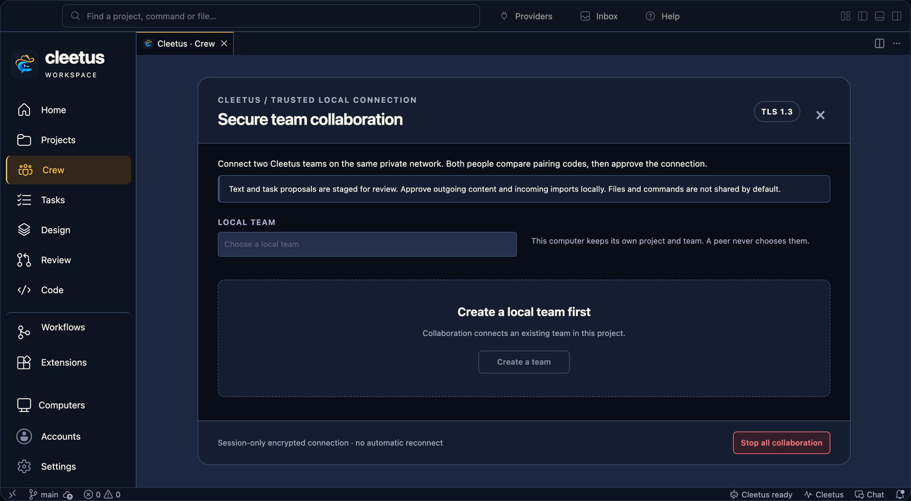

# Collaborate with another Cleetus team

Cleetus can connect two teams on the same local network through an encrypted TLS 1.3 channel. Each person chooses a local project and team, exchanges an invitation, compares the pairing code, and approves the connection.

Available in the **1.11.2 extension** and native **0.1.0-dev.3** development build. Both computers need Cleetus, a configured team, and OpenSSL available on `PATH` (`openssl version` should succeed).

*Native setup capture from a disposable project. It does not show an approved connection between two physical computers or a running provider.*

Collaboration is opt-in. Opening the dialog or reading status starts no listener. Each person controls the local project and team; starting its agents is not required to pair.

## Pair the teams

1. Open **Agents & Teams → Collaborate on LAN** in the extension, or **Teams → Collaborate on LAN** in the IDE.
2. Choose your local team. Its agents must belong to the project open in this window. Create a team first if the list is empty; creating it does not start agents.
3. On the inviting computer, choose the private network interface used by the other computer, enter a recognizable label, and choose **Start private listener**. Review the host approval before allowing it.
4. Choose **Create invitation**, then **Copy invitation**. Share this long invitation privately with the other person. It expires within ten minutes and can be used once.
5. On the other computer, choose its own local team, paste the invitation, choose **Join for local approval**, and review its host approval.
6. Compare the **eight-digit TLS comparison code on both computers** through a channel you trust. If they match, both people choose **Codes match · approve pairing** and approve within two minutes. Decline if the codes differ or the request is unexpected.

The copyable invitation establishes the encrypted connection. The eight-digit value binds the human comparison to this TLS connection; it is not a password or a substitute for the invitation. Team names and IDs can differ between computers; each Cleetus instance controls its own local scope.

## Send a proposal

Select an active paired channel and choose **Message** or **Task proposal**. Enter only the content you intend to share, choose **Send for explicit local approval**, then review the local approval dialog. Cleetus sends that exact text after approval.

The receiving person selects its active peer and reviews the complete proposal in **Team inbox**, then chooses **Review & import pending task**, **Review & save message**, or **Reject proposal**. Acceptance opens a separate local host approval:

- An accepted **task** becomes a pending local task with external provenance. Review it in Tasks, then run or assign it through the normal workflow.
- An accepted **message** goes into the approved team inbox. The team's agents can read it through their scoped Cleetus tools. It is not automatically delivered as an agent prompt or relabeled as the local user's instruction.
- A receipt distinguishes staging or acceptance from execution. Acceptance does not mean an agent started, completed work, or passed checks.

If the incoming approval is declined, the proposal is rejected and the sender receives a rejection receipt. If the local task board changes while approval is open, Cleetus rejects the stale proposal before importing anything; send a fresh proposal after review. Unexpected failures remain marked for reconciliation and cannot be accepted again automatically.

Pairing grants no filesystem, shell, MCP, provider-account or credential access. Incoming text stays untrusted evidence; local project instructions and existing engine/tool approvals still apply. Code changes continue through your normal version-control workflow. Files are not automatically synchronized or exported.

## Use it from agents

Agents in the selected local team can use these tools after pairing:

| Tool | Purpose |
| --- | --- |
| `cleetus_peer_list_peers` | List permitted peers for the authenticated local team. |
| `cleetus_peer_propose` | Request local approval to send a message or task proposal. |
| `cleetus_peer_read_inbox` | Read approved external messages, in bounded pages. |
| `cleetus_peer_read_receipts` | Read acceptance and rejection receipts. |

For example: “List our paired peers, propose that the other team review this component contract, and inspect their receipt before reporting progress.” The agent cannot create invitations, approve pairings, approve imports, or choose another local team's authority.

## Stop or reconnect

Use **Revoke selected peer** to close one channel, or **Stop all collaboration** to close this Cleetus instance's listener and channels. Closing Cleetus also closes them. Closing the collaboration dialog only hides its controls; use revoke or stop to end the connection. Existing local tasks and repository changes remain.

This first version uses session-only pairing. Disconnects, expiry, revocation and restarts require a new invitation; Cleetus does not automatically reconnect or replay requests. If delivery or an import is marked uncertain, inspect the other team's receipt and your local task board before creating another request.

The approved inbox and decision history are stored in the local Cleetus profile. Channels encrypt data in transit; this does not change the profile's existing local storage protections.

## Network requirements

Both computers must be on the same directly attached private IPv4 subnet. Select a concrete private interface; public addresses, wildcard listeners and IPv6 are not supported in this version. There is no automatic discovery, relay, port forwarding or firewall-rule change. Guest Wi-Fi isolation, a VPN or a firewall can prevent the connection.

If connection fails, verify the interface, update both installations, check that the invitation is current, and confirm the computers can reach each other. Missing OpenSSL or failed certificate validation stops pairing; Cleetus does not offer an unencrypted fallback.

[Teams](TEAMS.md) · [IDE workspace](IDE.md) · [Install and update](INSTALL.md)
