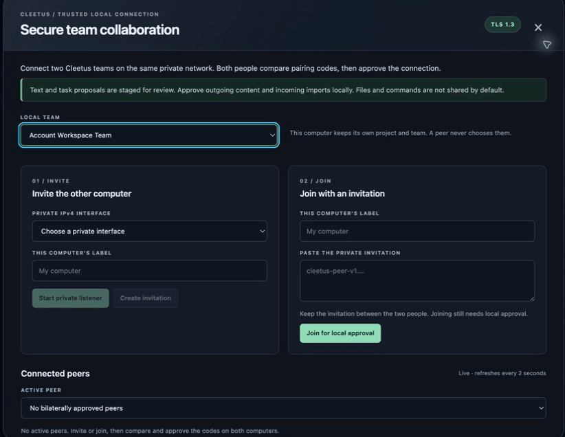
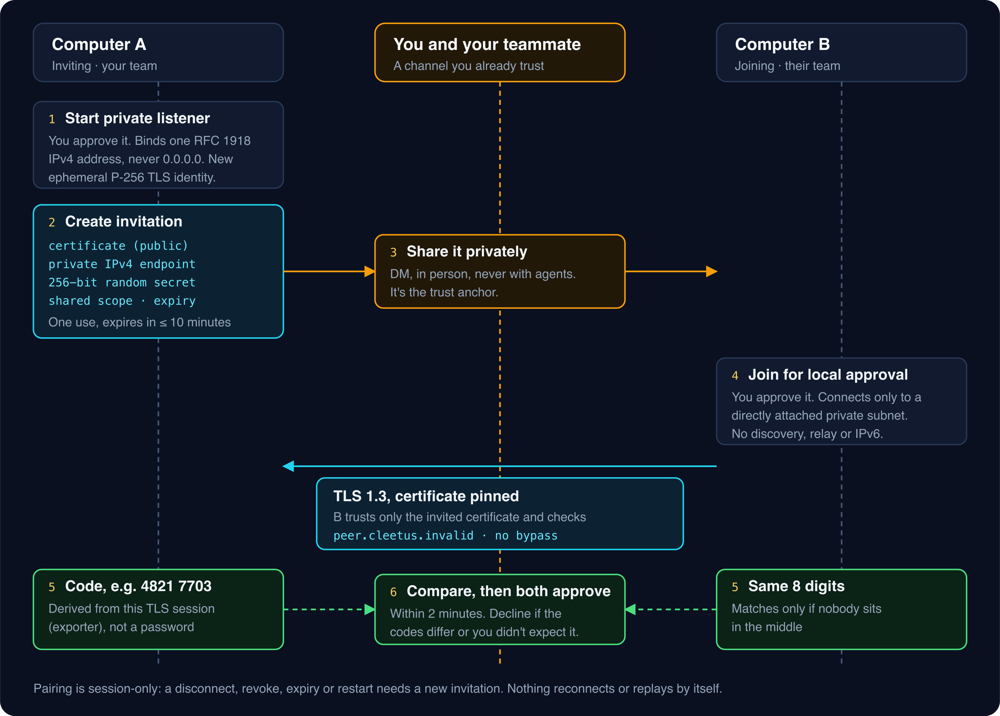
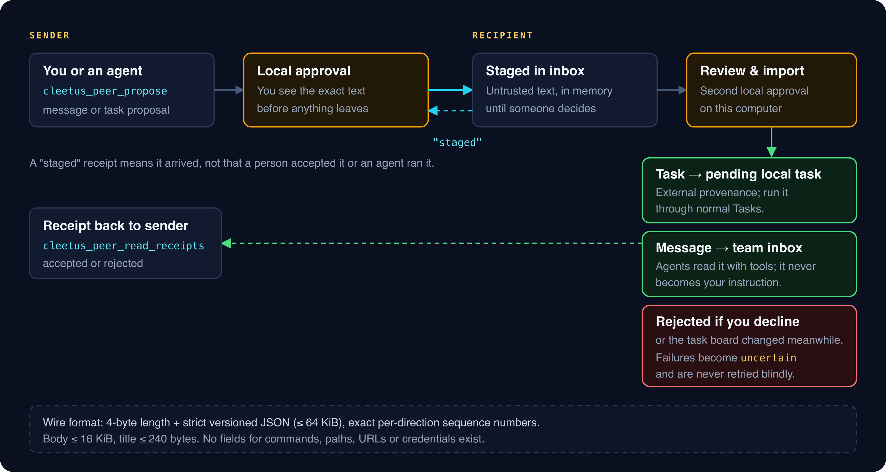

# Encrypted LAN collaboration

_Read this guide on [cleetus.dev](https://cleetus.dev/docs/lan-collaboration/)._

Pair your Cleetus team with a teammate's team on the same network and exchange messages and task proposals between them. The channel is TLS 1.3 with a pinned, single-use identity. Every message that leaves or enters your machine needs your approval, and pairing grants the other side nothing: no files, no shell, no MCP servers and no accounts.



_The collaboration dialog: choose your local team, then either invite the other computer or join with their invitation._

## How pairing works



The design rests on one idea: **the invitation is the trust anchor, and the comparison code proves nobody swapped it.**

1. **The inviting computer starts a private listener.** You approve it first. Cleetus binds one concrete private IPv4 address (RFC 1918) on an interface you choose, never a wildcard, and creates a brand-new P-256 TLS identity with OpenSSL for this session only.
2. **It creates an invitation.** The long invitation string carries the public certificate, the private endpoint, a random 256-bit secret, an opaque shared scope and an expiry. It can be used once and expires within ten minutes.
3. **You share it privately.** Send it over a channel you already trust. It never goes through agents.
4. **The joining computer connects.** It trusts only the certificate in the invitation, validates the hostname `peer.cleetus.invalid` and pins the exact certificate. There is no verification bypass and no unencrypted fallback. If OpenSSL or validation fails, pairing stops.
5. **Both screens show an eight-digit code.** It's derived from the live TLS session using the TLS exporter, so it only matches if both computers share the same session, with nobody in the middle. It isn't a password and can't replace the invitation.
6. **You compare codes and both approve within two minutes.** Decline if they differ or you didn't expect the request.

The opaque scope never contains a team ID, project path or workspace root. Each computer maps it to its own local team, so team names can differ between machines.

## Pair two teams

1. In the IDE, open **Teams → Collaborate on LAN**. Choose your local team. Its members must belong to the project open in this window, but they don't need to be running.
2. **Inviting:** pick the private interface the other computer can reach, enter a label, choose **Start private listener** and approve. Then **Create invitation** and **Copy invitation**.
3. **Joining:** choose your own team, paste the invitation and choose **Join for local approval**.
4. Compare the eight-digit codes, then both choose **Codes match · approve pairing**.

You need OpenSSL on `PATH` (`openssl version` must succeed) and both computers on the same directly attached private IPv4 subnet. There's no discovery, relay, port forwarding, IPv6 or firewall change. Guest Wi-Fi isolation, VPNs and firewalls can block the connection.

## Send and receive proposals



Select a paired channel and choose **Message** or **Task proposal**. You approve the exact text before it's sent. The recipient sees it in **Team inbox** and chooses **Review & import pending task**, **Review & save message** or **Reject proposal**, which opens a second approval on their machine.

- **An accepted task** becomes a pending local task marked with external provenance. It runs only through the recipient's normal [Tasks](TASKS.md) workflow.
- **An accepted message** goes to the team inbox. Agents can read it through their scoped tools, but it's never delivered as a prompt or relabelled as the local user's instruction.
- **Receipts** separate arrival from acceptance. `staged` means the message arrived; `accepted` or `rejected` reflects the recipient's decision. Neither means an agent ran the work or checks passed.

If the recipient's task board changes while the approval is open, the proposal is rejected before anything is imported; send a fresh one. If something fails mid-import, the entry becomes **uncertain** and can't be accepted again automatically. Reconcile the real outcome first.

## Let agents use it

After pairing, agents in the selected team get four tools. They can't create invitations, approve pairings or imports, or act for another local team.

| Tool                         | What it does                                          |
| ---------------------------- | ----------------------------------------------------- |
| `cleetus_peer_list_peers`    | List the peers this team may use                      |
| `cleetus_peer_propose`       | Ask you to approve sending a message or task proposal |
| `cleetus_peer_read_inbox`    | Read approved incoming messages, in bounded pages     |
| `cleetus_peer_read_receipts` | Read accepted and rejected receipts                   |

For example: _"List our paired peers, propose that their team review this component contract, and check their receipt before you report progress."_

## Wire protocol and limits

Each frame is a 4-byte big-endian length followed by strict, versioned JSON, up to 64 KiB, with exact per-direction sequence numbers on each socket. A proposal is one of two shapes, and unknown fields are rejected:

```json
{ "id": "review-contract-01", "kind": "task.propose", "title": "Review the card contract", "body": "…" }
{ "id": "note-2f9", "kind": "message.propose", "body": "…" }
```

IDs are 8–128 letters, digits, underscores or hyphens. Bodies are up to 16 KiB and titles up to 240 bytes. There are no fields for commands, paths, URLs or credentials, and receipts can't be forged through `send`.

| Limit                                               | Value          |
| --------------------------------------------------- | -------------- |
| Pending pairings and invitations                    | 5              |
| Sockets and channels                                | 32             |
| TCP admission attempts, including failed handshakes | 30 per minute  |
| Frames per socket                                   | 120 per minute |
| Inbox items                                         | 256            |
| Unacknowledged sends                                | 16             |
| Queued writes                                       | 256 KiB        |
| Authentication deadline                             | 10 seconds     |
| Idle timeout for an approved socket                 | 15 minutes     |

## Stop, revoke and reconnect

**Revoke selected peer** closes one channel; **Stop all collaboration** closes the listener and every channel. Quitting Cleetus also closes them, but closing the dialog only hides it. Pairing is session-only: after a disconnect, revoke, expiry or restart, start again with a new invitation. Cleetus never reconnects or resends by itself, and an acknowledgment timeout reports uncertain delivery and closes the channel.

The approved inbox and decision history are stored in your local profile. The channel encrypts data in transit; it doesn't change how your profile is stored.

[Agent teams](TEAMS.md) · [Tasks](TASKS.md) · [Security model](SECURITY_MODEL.md)
