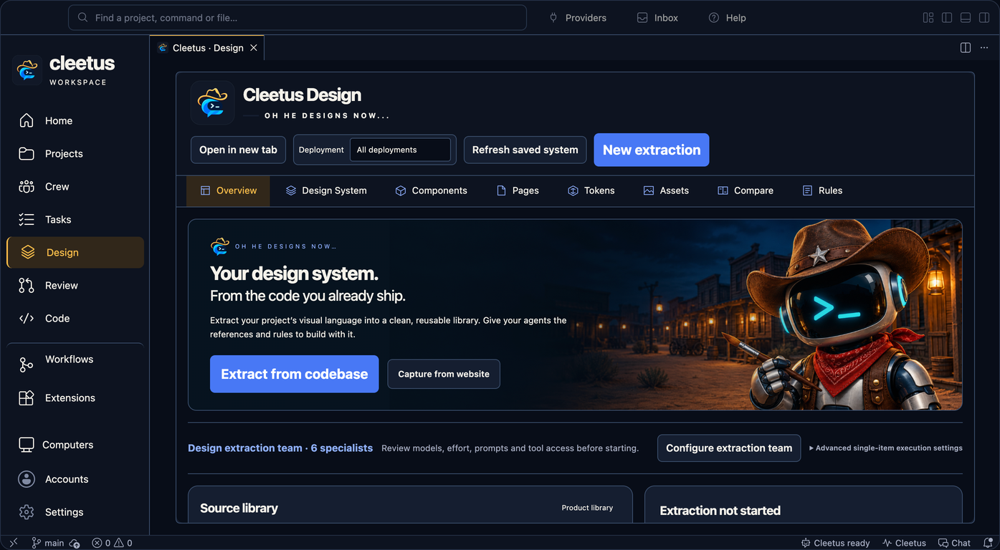
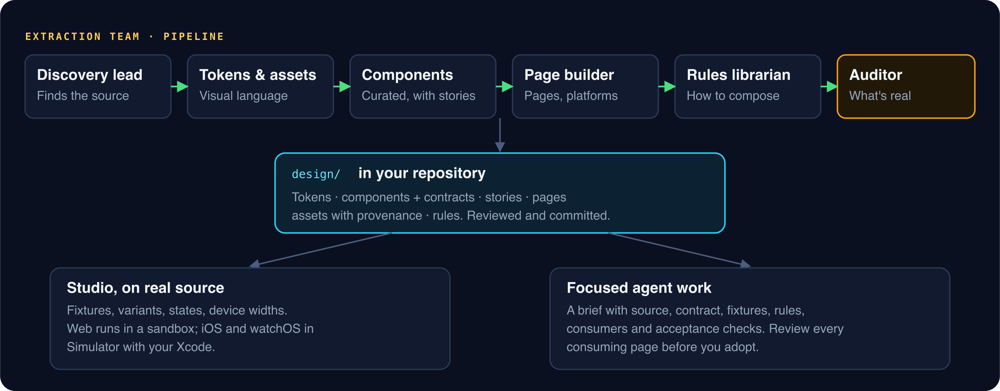

# Cleetus Design

_Read this guide on [cleetus.dev](https://cleetus.dev/docs/design/)._

Cleetus Design is a studio for the interfaces your agents actually build. It keeps a design system in your repository (tokens, components with contracts and stories, pages, assets and rules), renders the real source live, and turns a refinement into a focused brief an agent can act on.

## How it fits together

The design system lives in your project's `design/` folder as ordinary files you review and commit. The studio reads it, renders registered source through a [preview adapter](ADAPTERS.md), and gives agents the same files as context. Nothing is locked in a Cleetus database.

## Extract a design system

1. Open **Design → Overview** and select the project.
2. Choose **Extract from codebase**. Cleetus fills the repository and scope into a **Design System Extraction** team.
3. Keep the recommended models and effort (High), or override them for the team or for individual specialists.
4. Review each specialist's prompt and MCP access, then **Create & start extraction**, or create it without starting.
5. Read the auditor's report. It separates what was **discovered** in source from what was **built, rendered and verified**.

The six specialists run as a pipeline: a discovery lead finds the source, tokens and assets capture the visual language, a component curator registers composed components with contracts and stories, a page and platform builder maps pages and platforms, a rules librarian writes how things compose, and an auditor reports what's real. It's the same team engine as any other, with the same approvals and handoffs.

## Components are building blocks

A component can be a navigation system, an editor, a form flow or a card composition, not just a button. Component Studio renders the registered source with fixture props, variants, states, device widths and theme and background controls. Before changing a public API, check its usage, tokens, code and contract.

To change one, **prepare an agent task** from it. The brief includes the implementation, contract, fixture, rules, consumers and acceptance checks. Preparing a draft never sends it or starts agents. Review the live preview and every affected page before adopting the change. A pixel match proves neither behaviour nor accessibility.

## Pages, tokens, assets and rules

- **Pages** open with their current source, device previews, composition and related components. Long pages scroll inside their review viewport.
- **Tokens** keep the project's visual language, with semantic aliases.
- **Assets** keep their source and provenance, plus an explicit draft, approved or retired decision. Approve canonical mocks and logos you want agents to use as references.
- **Rules** explain intended composition and platform differences, in words agents read before they build.

## Product libraries

Link the design systems of several repositories that make up one product, such as responsive web, iOS and watchOS. See [Product libraries](LIBRARIES.md).

## Agents and Design

Agents use Design through the [local service](SERVICE.md): extraction, site capture, source rendering, component extraction, creation and checking, capture, comparison and mock cropping all run as background jobs, with the same approvals as any tool. The **Design tools** setting turns this off for agents and the UI alike.

[Live previews](ADAPTERS.md) · [Agent teams](TEAMS.md) · [Local service](SERVICE.md)
