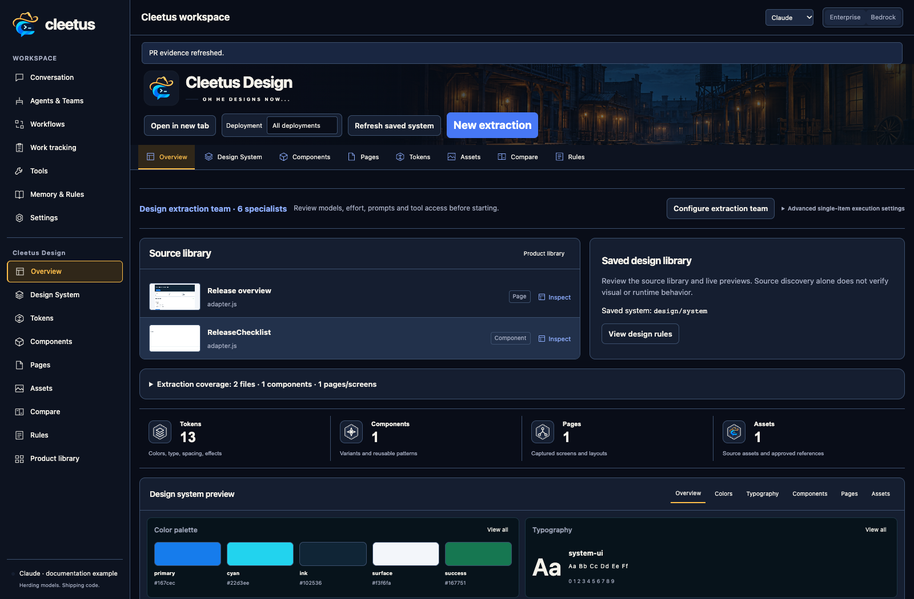
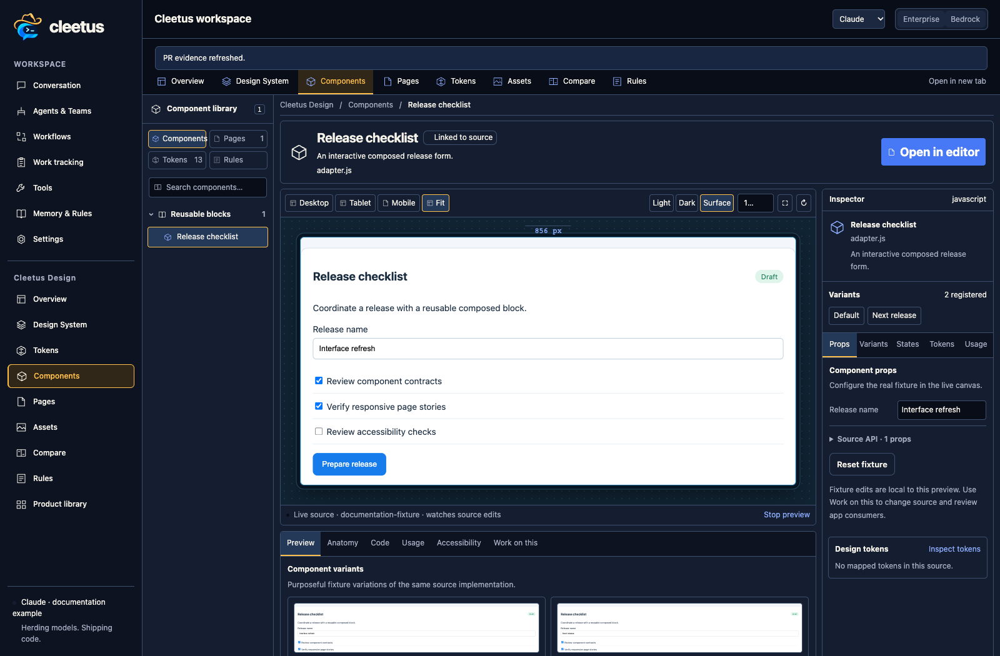
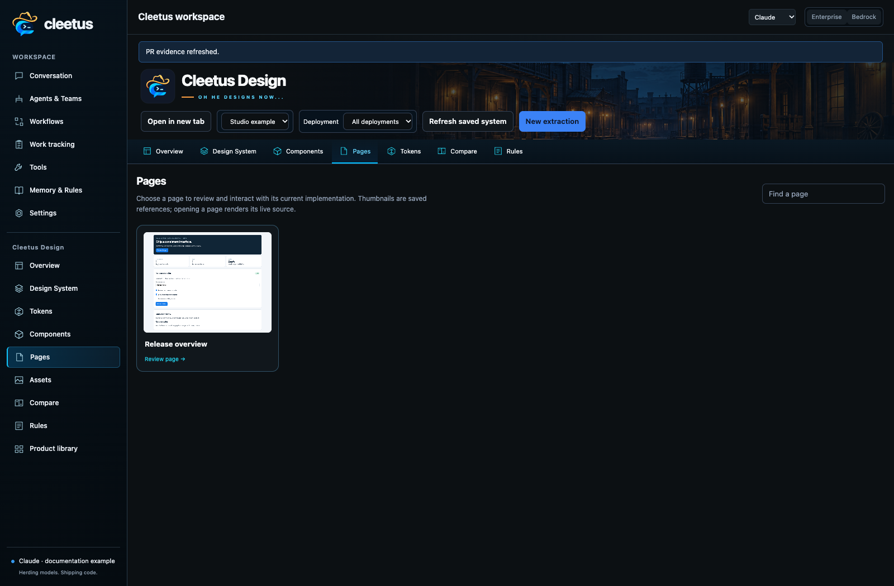

# Cleetus Design

Cleetus Design is a studio for the real interfaces your agents build. It combines repository-owned design systems, real source previews, component contracts, page composition, reference assets, and rules.

## Extract a design system

1. Open Design → Overview and select the project.
2. Choose **Extract from codebase**. Review the six-specialist extraction team and scope.
3. Keep recommended defaults or override available models and effort for the team or individual agents.
4. Inspect detailed role prompts and MCP assignments, then create/start the team.
5. Review artifacts and the audit: discovered source is different from built, rendered and verified coverage.

Beta 6 preserves the advanced selected engine/backend, model and effort when
preparing that team, including an explicit **Engine default**. Leaving an
override absent keeps the extraction preset. Review the resulting member
settings before starting; unavailable metadata is rejected without losing the
extraction draft or starting a provider.

The team discovers source; curates tokens/assets; registers composed components, contracts and stories; maps pages/platforms; writes rules; and audits the library. It uses the same agent system as ordinary development, with tool permissions and explicit handoffs.

## Components are building blocks

A component can be a navigation system, editor, form flow or card composition, as well as a primitive control. Component Studio renders registered project source with fixture props, variants, states, device widths and theme/background controls. Inspect usage, tokens, code and contracts before changing the public API.

Prepare an agent task from a selected component. Give it the implementation, contract, fixture, rules, consumers and acceptance checks. Review a live preview and impacted pages before adopting it. A pixel match does not prove behavior, accessibility or application correctness.

## Pages, assets, tokens and rules

Click a page card to inspect its current registered source, device previews, composition and related components. Long pages belong in a scrollable review viewport rather than stretching the whole gallery. Browser previews do not require a PNG for every change; optional snapshots remain useful for comparison/export.

Tokens preserve the project's visual language. Assets retain source/provenance and explicit draft/approved/retired decisions. Approve canonical mocks/logos when you want agents to use them as references. Rules explain intended composition and platform differences.

Working previews need project dependencies, controlled fixtures and a registered adapter. Source discovery alone cannot invent authenticated data or native screen hosts. Use [preview adapters](ADAPTERS.md) and [product libraries](LIBRARIES.md) for a complete multi-platform workflow.

## Visual context for connected agents

Beta 8 connects approved Design references to an agent's actual image-input
capability. Image-capable ACP conversations can receive up to four PNG/JPEG images
totaling 512 KiB; unsupported formats or larger references remain file/text
context with an explicit explanation. Cleetus verifies approved bytes and path
identity before automatic attachment. Modified or redirected files are not
silently presented as approved visuals. Save a replacement through the asset workflow and approve that new version.

Use [coding agent connections](CODING_AGENTS.md#review-screenshots-with-a-connected-agent)
for discovery, image limits and draft behavior. Format support is separate from
selected-model vision, native platform rendering and visual acceptance. Agents
still need the component usage contracts, tokens, rules and actual source; an
attached screenshot is a reference, not a replacement for those contracts.

## Coordinate refinement with the development team

A Design or extraction agent follows the same current execution ownership as
other Cleetus teammates. In Beta 9, a blocked specialist does not retire a still
active supervisor or parallel reviewer. Inspect the specialist’s saved findings,
answer the active agent’s question, then start any fresh work through the owning
Tasks or Teams view. Saved results and old approvals remain read-only.

Model and effort changes stay paired with the actual connected conversation.
Changing an ACP model clears its previous explicit effort; choose only settings
advertised for the new model. See [team coordination](TEAMS.md#work-through-a-blocked-teammate)
and [model settings](CODING_AGENTS.md#keep-model-and-effort-settings-together).
