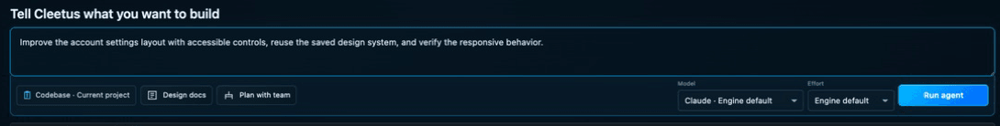
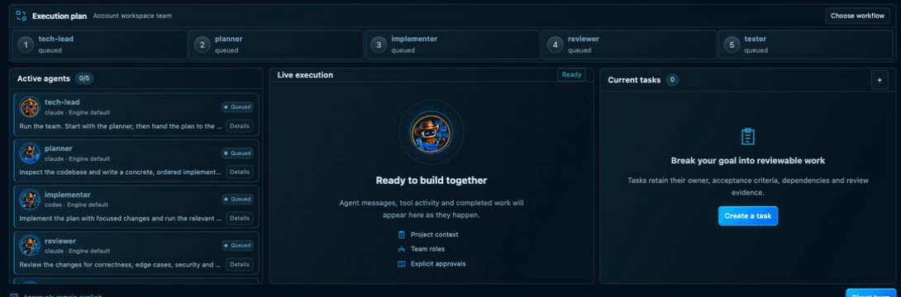

# Agent Command and conversations

_Read this guide on [cleetus.dev](https://cleetus.dev/docs/agent-command/)._

Agent Command is where work starts. You describe an outcome, pick an engine, model and effort, and follow the run: plan, active agents, live execution, tasks and the files agents report. Conversations are the same engines in a chat you can attach context to, search and resume.

## Give a goal

1. Connect Claude or Codex in **Get started**. See [installing engines](INSTALL.md#connect-your-engines).
2. Describe the outcome, the constraints and how you'll check it. _"Improve the account settings layout with accessible controls, reuse the saved design system, and verify the responsive behaviour"_ beats _"fix settings"_.
3. Choose a discovered model or **Engine default**, and an effort that engine supports. Models come from the engine's own capability list, never a free-form name.
4. Choose **Run agent**. Cleetus saves the goal and a linked execution task, then asks before starting the run. The approval shows the project and working directory.

**Plan with team** opens team setup instead. See [Agent teams](TEAMS.md).

_A ready team: queued members, an empty live execution panel and no tasks yet. Nothing has started._

## What the cards mean

Agent Command shows saved local state and nothing else:

- **Requested models are configuration.** What actually ran shows up only once the engine reports it.
- **Cost and activity are never inferred** from a template or a ready team. A ready team with no runs shows "Cost unavailable", not a guess.
- **Agent logs** are actual execution output. **Reported files** are artifacts an agent explicitly reported, linked back to source.

Opening a draft, choosing a template or viewing the dashboard never starts an agent.

## Conversations

Open a conversation from Agent Command, the action rail or **Cleetus: Open Studio**. Choose the engine, model, effort and permission mode, then attach files, selections, images or editor context.

- **Tool requests and diffs** appear inline. Approve, deny or edit them; see [approvals](TOOLS.md#the-permission-flow).
- **Stop** interrupts the engine. It doesn't undo earlier writes; review the project after stopping.
- **History** lets you search, group, bookmark, archive and export sessions. **Continue conversation** resumes the exact saved project session with its native engine identity.

## How resume works

Each conversation is a core **session** with an engine ID, working directory, model, effort and permission mode. Final messages and tool and permission events are appended to a JSONL transcript in your profile; transient streaming frames aren't stored.

Resuming reloads that transcript and recreates the engine adapter with the engine's own session ID, so Claude or Codex continues its native session. It doesn't revive a suspended process, and changing engines never moves a session between vendors. A transcript is a record, not a running agent.

Sessions created for fenced task work offer **Inspect saved output** instead of continuing. New work on that task goes through its own run flow, so its [execution lease](TASKS.md#execution-leases-and-fencing) stays valid.

## Keyboard and commands

| Do this                    | How                                               |
| -------------------------- | ------------------------------------------------- |
| Focus Agent Command        | **Ctrl+Cmd+I** on macOS, **Ctrl+Alt+I** elsewhere |
| Open the full Studio       | **Cleetus: Open Studio**                          |
| Back to source and preview | **Cleetus: Open Development Workspace**           |
| Preview the current file   | **Cleetus: Preview Current File**                 |

[Agent teams](TEAMS.md) · [Tasks](TASKS.md) · [Tools, MCP and approvals](TOOLS.md)
