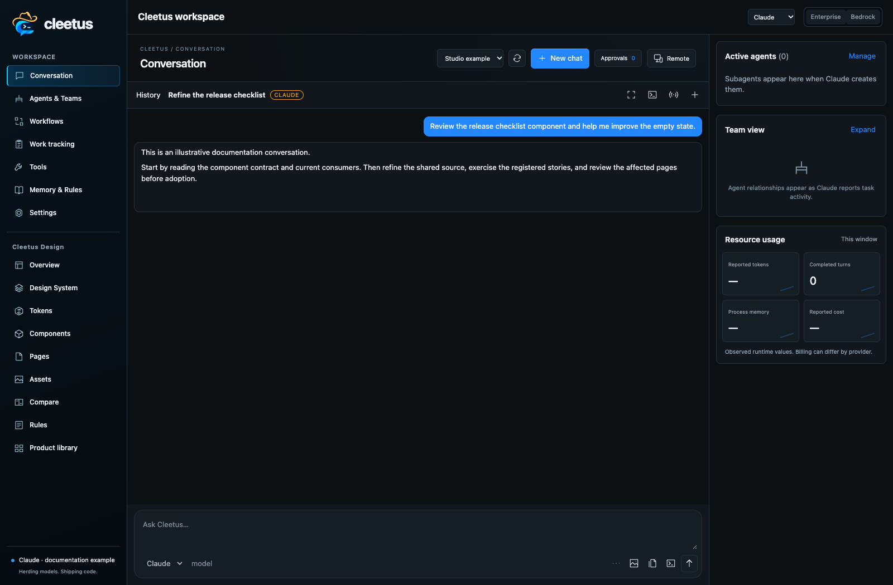
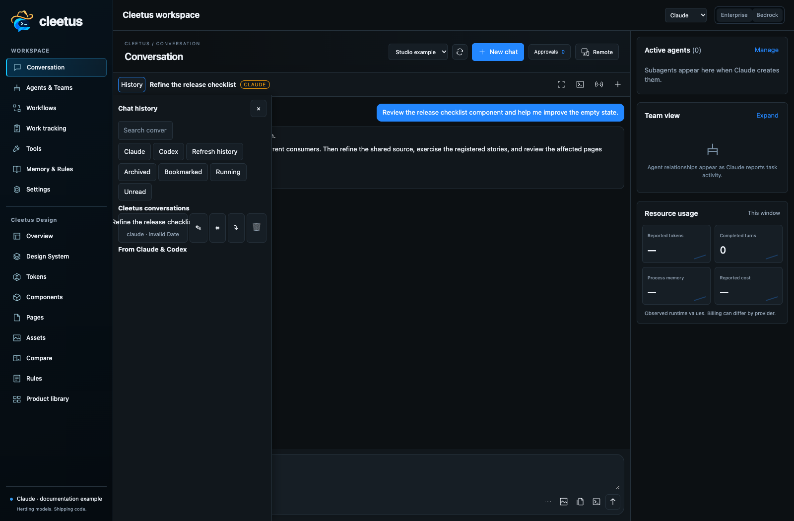

# Your Cleetus workspace

The shared sidebar connects Conversation, Agents & Teams, Workflows, Work tracking, Tools, Memory & Rules, Settings, and Design. Design stays in the same workspace; a second tab is an explicit choice.

## Conversations and history

Choose Claude or Codex, an available model, effort and permission mode. Models come from engine capabilities rather than free-form names; catalogs distinguish their engine/backend. Attach files, selections, images or editor context, then send a focused request.

Inspect actual tool requests and proposed diffs. Permissions may come from session rules, native engine modes, hooks or an explicit approval card. Stop interrupts execution; it does not undo earlier writes. Review the result and validate the changed project.

Open History to find and resume earlier conversations, with engine/native identity retained where supported. Sessions support search, grouping, archive and export. A stored transcript is not a resumed local process, and changing engines does not move a native session between vendors.

## Pick the right workflow

Use one conversation for a bounded task, a workflow recipe for a reusable request, or a [prebuilt team](TEAMS.md) for explicit roles and handoffs. Use [Design](DESIGN.md) to inspect/refine reusable components and pages before asking agents to adopt changes.

[Work tracking](WORK_TRACKING.md) can prepare a conversation or team with source issue details and acceptance criteria. Preparing a draft does not send it or start agents. [Tools](TOOLS.md) controls MCP and developer tooling. Memory & Rules keeps project/user instructions close to the work.

## Storage and settings

Cleetus stores its profile separately from your repository, normally under `~/.cleetus/profile`. Settings → Storage shows the actual location. Project design artifacts remain in the project's `design/` folder. Native runtime credentials retain their storage behavior.

Stop work before moving/backing up a profile. Account tokens and native secure storage are not portable merely by copying profile files. Provider/environment changes may require a reconnect or reload. Keep private transcripts, credentials and job records out of public repositories.
