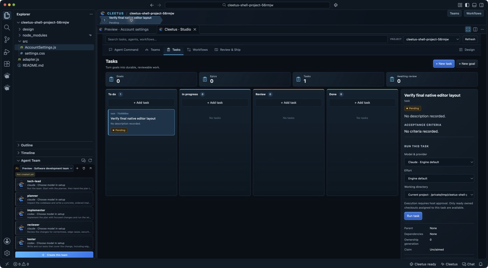
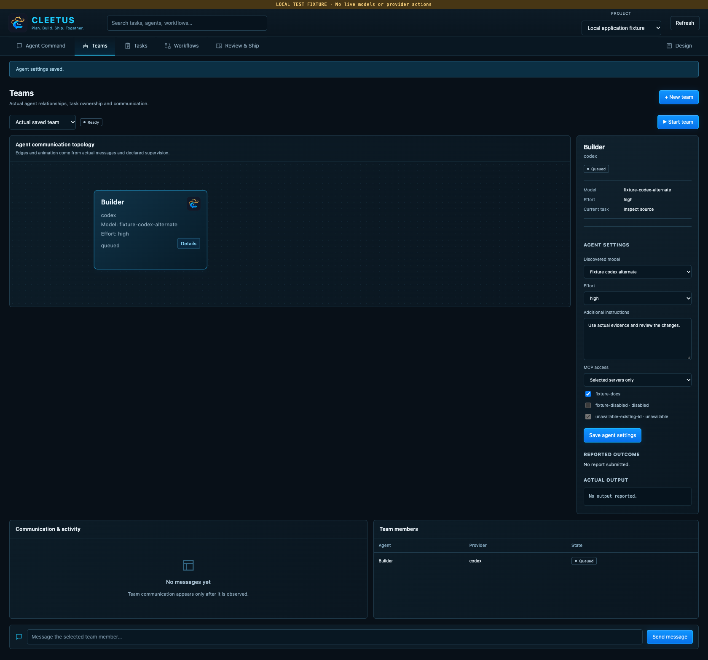
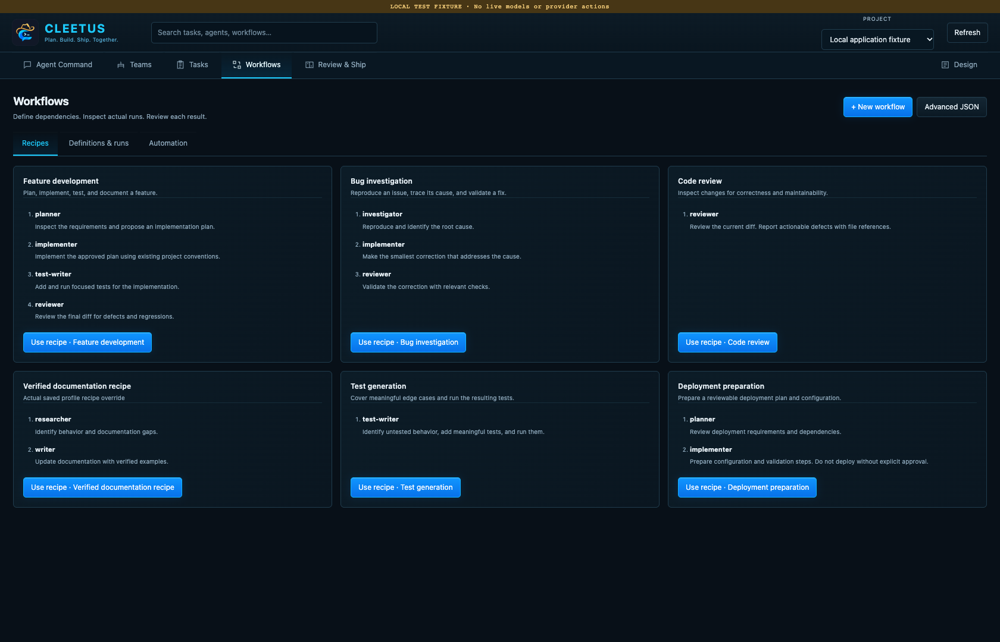
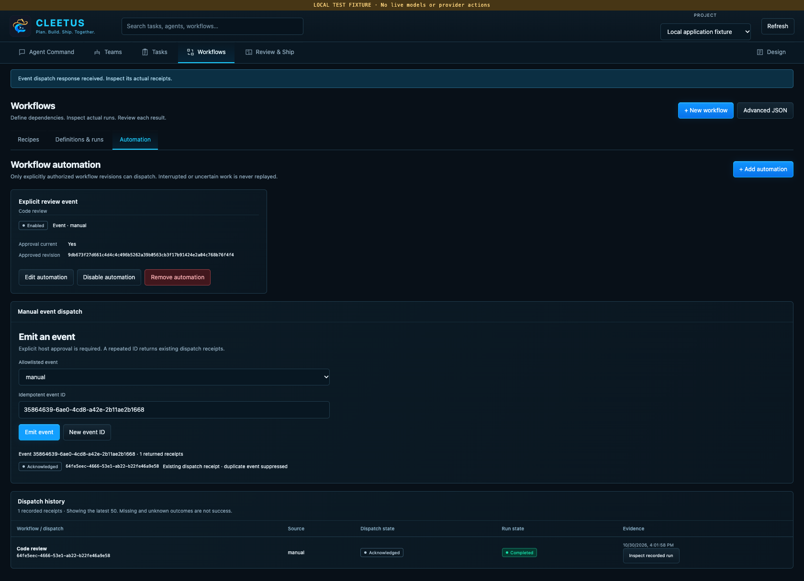
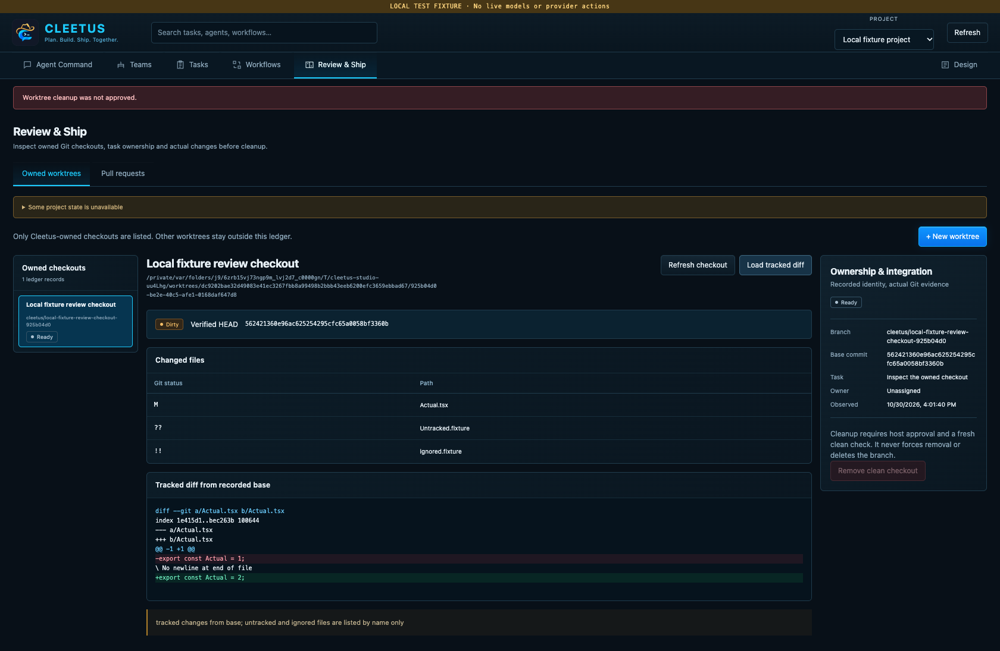

# Cleetus IDE and Studio

Cleetus IDE combines a Code OSS editor with Cleetus Agent Command, teams, tasks, workflows, review, and Design. The existing Cleetus extension remains a separate product for ordinary VS Code.

| Distribution | Availability |
| --- | --- |
| **Cleetus VS Code extension** | Stable public VSIX. Follow [Install and update](INSTALL.md). |
| **Cleetus IDE 0.1.0-dev.2** | Unreleased local development build. The current macOS app is unsigned and unnotarized. A signed public IDE installer is **not available yet**. |

This guide describes the current development interface. Do not treat a development app or unsigned archive as a signed public release. Public installation instructions will accompany a signed, published IDE package when one is available.

## Open your workspace

If you have an authorized development build:

1. Open Cleetus and choose a project folder. Use the normal Explorer, editor, integrated terminal, source control, and compatible language/debug extensions alongside your agents.
2. Connect Claude or Codex through Cleetus **Get started**. Their runtimes and accounts are separate installs; use the same [engine setup](INSTALL.md#connect-your-engines) as the extension.
3. Run **Cleetus: Open Development Workspace** from the Command Palette. The compact **Agent Team** sits beneath Explorer, **Agent Command** sits on the right, and the real source editor and preview share the center.
4. **Cleetus: Focus Agent Command** focuses the right command pane. Its **Engines** action opens the existing engine setup; **Open conversation** opens Cleetus chat. The IDE shortcut is **Ctrl+Alt+I**, or **Ctrl+Cmd+I** on macOS. **Open Cleetus workspace** in engine setup returns to the development layout.
5. Use **Cleetus: Open Studio** for the full **Agent Command**, **Teams**, **Tasks**, **Workflows**, **Review & Ship**, and **Design** screens. Studio expands the editor canvas and temporarily hides the right command pane while keeping Explorer available. Run **Cleetus: Open Development Workspace** to restore source and the current preview side by side.

The native workflow strip above the editor shows recorded team members, workflow steps or tasks and their actual states. Select an entry to inspect its work in Studio. An empty workspace has no invented execution plan or progress.

Cleetus provides the IDE's agent experience. The upstream vendor chat/runtime is omitted from this development distribution; Copilot is a possible future engine, not an available Cleetus engine today. Claude and Codex remain the current supported choices.

The IDE uses its own application identity, settings, extension directories, and launch profiles. It can coexist with VS Code without moving your VS Code settings or credentials automatically. Install compatible extensions from Open VSX or a reviewed VSIX. Availability and licensing vary by extension; installing one does not supply a model subscription.

## Start with one goal


*Actual unsigned dev.2 native app in a disposable acceptance project. The displayed team is a template marked **Not created yet**; the sample task is pending. No agents were launched for this capture.*

1. In **Agent Command**, choose a connected engine, a discovered model or **Engine default**, and an effort offered by that engine.
2. Describe the outcome, relevant constraints, and how you will check the result. Submitting the goal saves a goal and a linked execution task before requesting a run.
3. Read the native approval dialog, especially its project and working directory. Allow only the work you intend to run.
4. Inspect actual output and tool requests. Agent progress and team communication come from observed events; a requested model setting is not proof of provider-reported execution metadata.

The left team cards show real roles, model settings and state once a team exists. Before creation, they preview saved template roles with **Not created yet** and **Create this team**. The right pane shows the selected team’s topology and recorded messages, tool activity, timeline and file references. Choosing a template or opening a view starts no agents.

Use a conversation for a focused question. Use a task when you want durable acceptance criteria, ownership, and a separate review decision. A stopped run retains source changes already made.

## Keep tasks reviewable



*Actual native dev.2 capture of the same disposable project. The right command pane is folded away for Studio; Explorer and the compact team preview remain. This pending task has not run an engine or produced an approved result.*

In **Tasks**, use **+ New goal** or **+ New task**. Give tasks a concrete title, description, acceptance criteria, and an appropriate parent. Select a card to read its report and ownership details. The board separates pending, running, review, and completed work.

Choose **Run task** for a pending task, inspect the engine and working directory in its approval, then follow the result. Dependencies must be completed and approved before a dependent task can be claimed. Claims have an owner, expiry, and fencing generation: an expired or replaced owner cannot submit work using an old claim.

An agent report or ended turn sends work to **review**; it does not approve its own changes. Inspect the actual files, diff, checks, and reported evidence, then choose **Approve result** or **Request changes**. Completion is your review decision, not a claim that every check passed automatically.

### Choose isolation explicitly

**Review & Ship → Owned worktrees → + New worktree** creates a separate checkout and branch from the current committed HEAD. Associate it with an existing task and review the native approval. Uncommitted changes in the primary checkout stay there.

Select the task in **Tasks** and choose its engine/model, effort and working directory. The checkout menu offers the current project and ready owned worktrees associated with that exact task. Creating a worktree alone does not redirect a run; choose it explicitly, then confirm its path in the approval dialog. Follow the execution receipt, use **Stop execution** when needed, and inspect the saved session output before review.

Task ownership remains on the primary project's board even when an authorized run uses an isolated checkout. Stale leases, changed Git identity, or another task's worktree do not grant access. Worktree bindings are not restored automatically from session history.

A worktree separates checkout files; it is not an operating-system sandbox. Existing engine tool permissions and project trust still apply.

## Give a team a bounded goal



Open **Teams → + New team**, choose one of the [nine prebuilt teams](TEAMS.md#which-team-should-i-choose), and inspect its members before creating it. Templates cover delivery, UI design, design extraction, review, debugging, security, refactoring, documentation, and a lean pair.

Review each role, task, system prompt, engine, model, effort, and supervisor setting. Models come from the connected provider catalog; missing choices are unavailable, not substitutes. A blank member effort uses the team setting. A supervised team needs a Claude supervisor.

Creating a team does not start it. Choose **Start team** and approve its actual configuration. Inspect the communication graph, messages, member output, and reports; send direction to the selected member when needed. Pipelines wait for explicit reports, parallel members need separate file ownership or deliberate isolation, and supervisors direct their members.

Saved history retains results and messages. A live team remains owned by its launching coordinator. Historical or interrupted work is read-only, and restarting the editor does not replay queued handoffs or reattach arbitrary processes. Review the retained changes before starting new work.

## Define a workflow, then inspect its runs



1. Open **Workflows → Recipes** and choose a starter for feature development, bug investigation, review, documentation, tests or deployment preparation. Enter your goal and choose a discovered model/effort, then create its saved DAG. Use **Advanced JSON** for a custom definition; give each step a unique ID, supported action, input and `dependsOn` list.
2. Use **agent-task** for a bounded Claude/Codex request or **design-extract** for source Design extraction. The editor validates actions and rejects missing or circular dependencies.
3. Save the definition and inspect its graph. Independent steps may run in parallel; a dependent step waits for its predecessors.
4. Choose **Run workflow** and approve the displayed steps. Inspect the resulting run journal and node states separately from the saved definition.

Editing a definition does not rewrite earlier runs. Failed predecessors block dependent steps. The current agent and Design actions do not retry side effects automatically. Cancellation and timeouts request a stop; noncooperative work remains uncertain until it settles. An interrupted run is not replayed after restart.

For a first definition, adapt this read-only request to an engine you have connected:

```json
{
  "name": "Inspect a component",
  "steps": [{
    "id": "inspect",
    "action": "agent-task",
    "input": {
      "engine": "codex",
      "prompt": "Inspect an existing component and its tests. Report file references and gaps; do not change files."
    },
    "dependsOn": [],
    "timeoutMs": 300000,
    "maxAttempts": 1
  }]
}
```

### Scheduled and named-event automation

The shared host supports approved intervals of **60 seconds to 7 days** and allowlisted named events: **project.changed**, **task.reviewed**, and **manual**. These names are explicit host events; a file edit or task review does not implicitly emit one merely because its name matches.

Automation requires a separate human authorization for the exact workflow revision and trigger configuration. Workflow edits invalidate that authorization. Missed intervals are skipped after restart, overlapping runs are skipped, and failed or uncertain dispatches stop further automation for review. Event deliveries use durable identities to prevent duplicate execution.

Open **Workflows → Automation → + Add automation**, choose a saved workflow, and configure an interval or named event. New automation starts disabled. Enabling or changing it opens the host approval for that exact revision. Use **Disable automation** or **Remove automation** to stop future dispatch.

**Emit an event** is an explicit, approved action. Reusing the same event ID returns its existing receipts; choose **New event ID** for a separate intended delivery. Inspect dispatch history and its linked run journal. Closing a trigger service stops future dispatches; accepted work keeps its runtime cancellation/recovery behavior.



## Review changes before shipping



In **Review & Ship**, choose the evidence you need:

- **Owned worktrees:** select a checkout, use **Refresh checkout**, inspect its branch, recorded base, task association, and changed files, then **Load tracked diff**. Truncated output is marked. Untracked and ignored files are listed by name; their content is not part of the tracked diff.
- **Pull requests:** choose a configured GitHub tracker and PR. Review checks, review state, and merge evidence for the current head. Missing, skipped, stale, or unavailable checks stay distinct from a pass. Open the provider link for the repository's normal review and merge process.

Cleanup asks for explicit approval and removes only a verified clean Cleetus-owned checkout. Tracked, untracked, and ignored files block removal. The branch is retained, and unrelated worktrees are outside this ledger. Review & Ship does not automatically merge or cherry-pick changes.

## Keep Design beside the source


For daily iteration, open a registered source file and choose **Preview current file** in Agent Command, or run **Cleetus: Preview Current File**. Cleetus opens that source in the native editor and its registered page/component preview beside it. If a choice is needed, select the item from the project’s Design catalog.

The web preview starts in **Fit canvas**. Choose **Desktop**, **Tablet** or **Phone** to inspect a fixed width; use **Source** to focus the implementation and **Reload** for a fresh preview. Saved source edits rebuild the live preview. Exercise form fields and buttons with controlled fixture data; their behavior comes from your actual adapter and source. Inspect visible build errors when a change cannot render.

Use **Design Studio ↗** in the preview, or **Design** in Studio, for the shared Design viewer. Extract a system, inspect tokens/assets/rules, render registered components and pages, and prepare an agent refinement task with source-linked context. **Cleetus: Open Development Workspace** returns to the editor/preview split. Opening a draft does not send it or start agents.

Registered Apple items use the native adapter path: the preview pane offers **Open native preview** and **Build log**, while the real interface runs externally in Apple Device Hub/Simulator for iOS or watchOS. Install Xcode, the required toolchain and Simulator runtime first. Discovery is not proof of a successful Debug story build or render; inspect its logs and native result. Android source discovery currently has no native preview renderer.

[Design workflow](DESIGN.md) · [Web and Apple adapters](ADAPTERS.md) · [Product libraries](LIBRARIES.md)

## Accounts, approvals, and updates

Connect accounts locally. Secure credentials stay in the host's credential store or the provider's supported runtime configuration; copying a profile does not transfer secure login state. Heavy Design jobs and tracker/PR work use the local service. Normal engine tool permissions and explicit host approvals still apply.

The stable extension updater uses public release metadata, verifies VSIX size and SHA-256, and offers an explicit installation choice. It does not update the native IDE application. The IDE checks its own platform-specific public releases separately. A notarized Developer ID installation can stage a newer signed installer after verifying its checksum, publisher, bundle identity and notarization, then rechecks it before your explicit **Open installer** choice. Unsigned development builds can view published release notes but cannot use that verified installer path. No signed public native installer has been published yet. See [installation](INSTALL.md), [local service](SERVICE.md), and [licenses](LICENSES.md).

The editor-layout and Tasks images are actual native development-app captures from a disposable project, with a not-created team template and a pending task. Other screenshots are labeled local application/transport fixtures, and the Design artwork is promotional. These images do not establish live provider execution or validation of your project.
