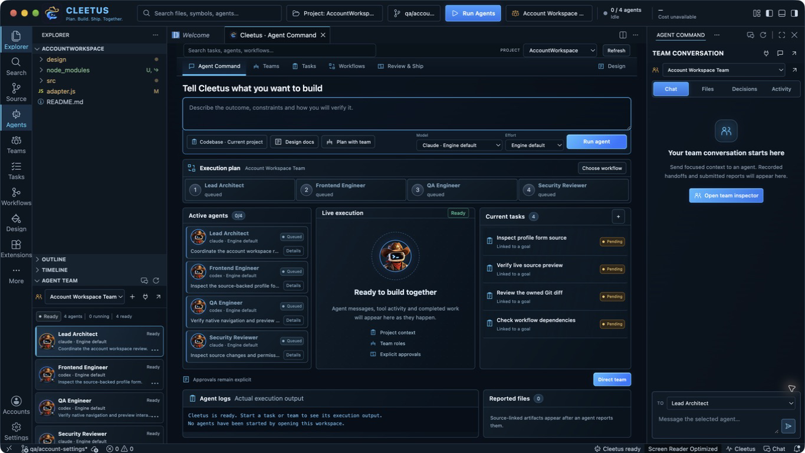
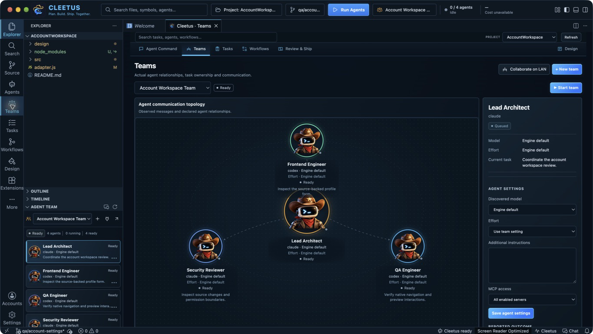
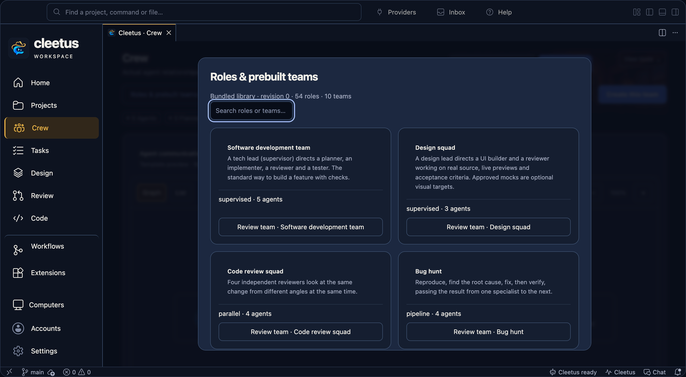
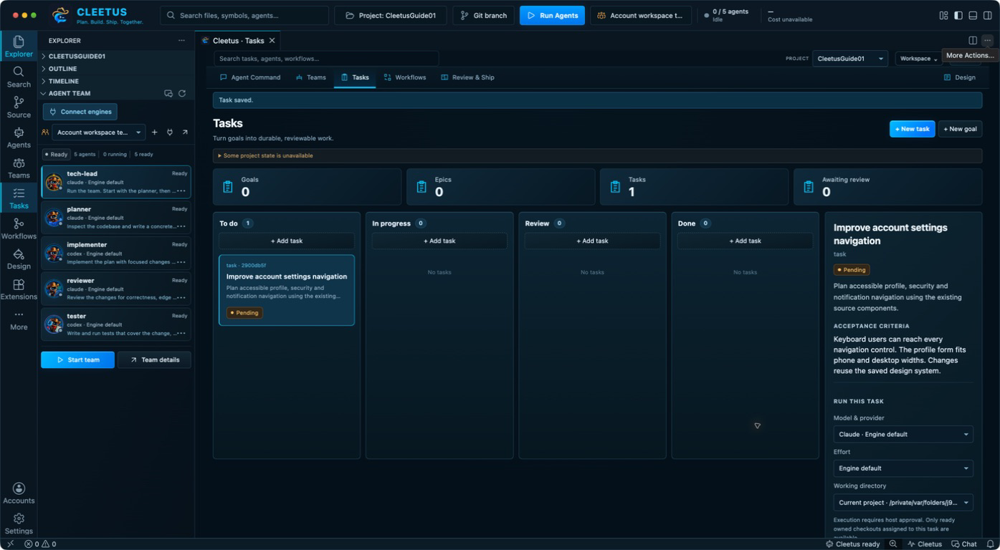
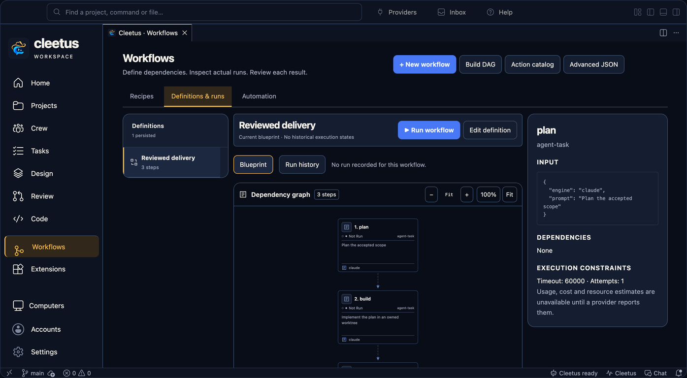
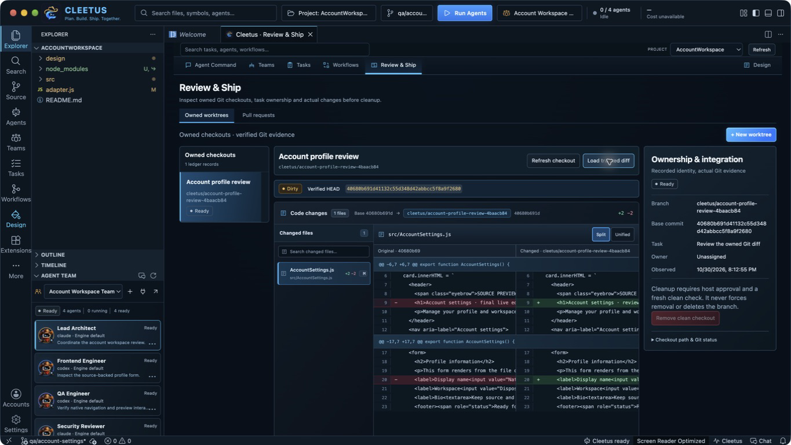
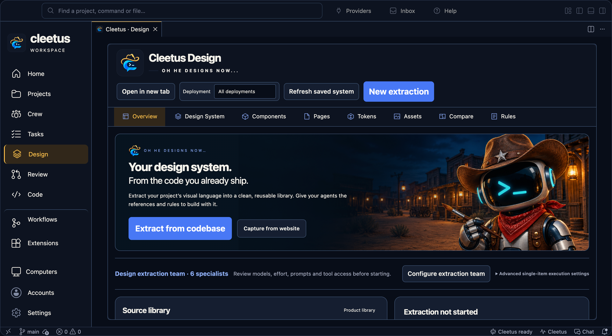

# Cleetus IDE and Studio

Choose the latest stable IDE in the [public releases listing](https://github.com/SnowBiz/cleetus-releases/releases), or the independent [latest extension release](https://github.com/SnowBiz/cleetus-releases/releases/latest). See [installation and release notes](INSTALL.md) for checksums, provider setup and capability limits.

_Read this guide on [cleetus.dev](https://cleetus.dev/docs/ide/)._

Cleetus IDE puts a Code - OSS editor, agents and a source-linked Design studio in one workspace. It's a complete editor that replaces VS Code. If you'd rather stay in VS Code, the maintained extension uses the same Cleetus application and is distributed independently.

| Product | Choose an accepted release |
| --- | --- |
| **VS Code extension** | Choose the latest stable universal VSIX whose notes include current native Claude Code setup, with matching `SHA256SUMS` in the [public releases listing](https://github.com/SnowBiz/cleetus-releases/releases). [Install and update](INSTALL.md#install-the-extension-instead). |
| **Cleetus IDE** | Choose the latest stable macOS Apple Silicon IDE whose notes describe the current native Claude Code connection. Download its DMG and `SHA256SUMS` from that same [release listing](https://github.com/SnowBiz/cleetus-releases/releases). |

Choose current release notes describing the native Claude Code flow. Older SDK subscription-flow builds
are retired from the recommended setup path. See [installation](INSTALL.md) for
the current downloads, checksum checks and engine setup.

The screenshots show the earlier Cleetus IDE 0.1.0 interface with an isolated sample project: ready, unstarted members, a pending task, a saved workflow with no runs, a real local Git diff and live source previews. Models, activity and cost are not simulated as live execution. No providers were started for these captures; they do not establish live account work, customer extraction or physical two-computer LAN acceptance.

## Install and open your project

Open the [public releases listing](https://github.com/SnowBiz/cleetus-releases/releases) and choose the latest stable Apple Silicon IDE whose notes include the current native Claude Code connection. Download its DMG and `SHA256SUMS` from that release, compare the full checksum, open the DMG, and drag **Cleetus.app** to **Applications**. Launch Cleetus and open your project folder. You do not need a separate VS Code installation.

The covered Preview License allows free personal and commercial use; already-granted preview and Apache rights remain unchanged. Native Claude Code uses your own installed CLI and native sign-in, not the SDK runtime. Codex and supported ACP agents use their documented executables. The SDK runtime is only for optional Claude API/cloud access; consumer Claude subscription sign-in through it is not offered. Provider accounts and model charges remain separate. Use Node.js 22+ and npm where your chosen runtime requires them, then follow [complete installation and engine setup](INSTALL.md).

In builds with **Cleetus: Connect coding agents**, run that command or choose **Agents** in Studio's top bar to connect your own Copilot, Kiro V3, Gemini CLI, OpenCode or custom ACP agent. Follow [coding-agent connections](CODING_AGENTS.md) for installation, native sign-in, launch approvals and capability limits. This feature is separate from the availability of the installer linked above.

## Open the source and preview workspace

Open a project folder, then run **Cleetus: Open Development Workspace**. Explorer and the compact Agent Team dock sit on the left; the native source editor and registered live preview share the center; Agent Command stays on the right. The branded command bar and labeled action rail provide access to the editor, Agent Command, Teams, Tasks, Workflows, Review and Design. **More** retains other editor views, including debugging. The native preview includes the pinned open-source JavaScript/Node debugger: set a source breakpoint, choose a Node launch configuration in Run and Debug, and inspect variables, stacks and expressions. Other languages require their compatible debug extensions.

The workflow strip above the editor uses actual team members, tasks or workflow steps. Select a stage to inspect that recorded item. Existing editor tabs, split resizing, terminal, source control and compatible language extensions remain available.

Run **Cleetus: Preview Current File**, or choose **Preview current file** in Agent Command, for a registered page or component. Choose **Fit canvas**, **Desktop**, **Tablet** or **Phone**; save source changes to rebuild the preview. **Source** focuses its implementation and **Reload** refreshes the preview. Buttons and forms run the actual registered source with controlled fixture data. Build failures remain visible.

Use **Cleetus: Focus Agent Command** for the right dock (**Ctrl+Alt+I**, or **Ctrl+Cmd+I** on macOS). **Engines** opens provider setup; **Account** opens your separate Cleetus profile and membership; **Open conversation** opens Cleetus chat. Use the native rail or **Cleetus: Open Studio** for the full Studio screens, and **Cleetus: Open Development Workspace** to return to source and preview. Studio expands into the editor canvas while retaining the compact team dock; the conversation pane is reserved for wide Agent Command layouts.

The **Workspace** menu opens existing **Tools & security**, **Work tracking**, **Memory & Rules** and **Cleetus settings** in the retained shared workspace editor tab. It preserves the selected project and your Studio/Design/source tabs. These are shared workspace screens, not separate native implementations. From **Review → Pull requests**, **Configure GitHub** takes you directly to connection setup; return and choose **Refresh** to load the configured connections.

The IDE has its own application identity, settings, extension directories and profiles. It doesn't import VS Code settings or credentials automatically. Install your extensions from Open VSX or a reviewed VSIX; Microsoft's marketplace-only extensions aren't available, and each extension keeps its own license. Cleetus supplies the agent interface for Claude Code, Claude API/cloud, Codex and supported ACP connections; the upstream vendor chat/runtime is omitted from this build.

## Give Agent Command a goal

The central Agent Command brings the goal composer, plan, selected team, recorded sessions, tasks, activity and reported files together. Its cards reflect saved local state. Requested models are configuration; provider-reported execution metadata remains unknown until reported. Cost and activity are not inferred from a template or a ready team.

1. Connect your own coding agent through **Get started** or **Agents** using the [engine setup guide](INSTALL.md#connect-your-engines). Cleetus account sign-in is separate from provider authentication.
2. Choose a discovered model or **Engine default**, and an effort supported by that engine.
3. Describe the outcome, constraints and acceptance checks. **Run agent** saves the goal and linked execution task before requesting a run.
4. Review the native approval, including project and working directory, then inspect actual output, tool requests and edits.

**Saved conversations** remains visible alongside team templates and created teams. Choose **Continue conversation** for the exact saved project session. Sessions created for fenced task work offer **Inspect saved output**; use the task workflow for a new execution lease. Design agent handoffs open their actual conversation instead of leaving you on the dashboard.

Ordinary agent conversations also retain the current opened-project
and application authority. Removing or replacing the project, or closing Cleetus,
retires the observed connection's queued messages and decisions. Reopening the
same folder does not restore an old grant. Reconnect explicitly to obtain fresh
approval and resume history without replaying its previous prompt. Saved output
remains available for inspection; changes already dispatched are not rolled back.

Cleetus retains ended conversation history in the dock and focuses the exact live
Claude terminal for native fallback. Shared chat keeps a submitted draft through
launch approval and local preflight; rejection preserves text and image chips,
and a late response cannot erase newer edits. Supported ACP engines can receive
bounded screenshot input after explicit capability discovery. See the
[coding-agent guide](CODING_AGENTS.md#review-screenshots-with-a-connected-agent).

Cleetus keeps the agent workspace composer consistent through live refreshes.
**Sending…** means one local request is pending, so refresh cannot submit it again.
New text written during that request stays in the composer. Read-only team
history keeps its messages and recorded questions without presenting old approval
buttons as active. See [blocked teammate behavior](TEAMS.md#work-through-a-blocked-teammate).

**Plan with team** opens team setup. Opening a draft, choosing a template or viewing the dashboard starts no agents. A stopped run retains changes already made; review them before continuing.

### Setup and reconnect without losing your draft

Cleetus keeps ordinary Claude Code setup separate from reconnect.
Choose **Complete native setup** or **Open Claude Code** to focus the existing
terminal for native sign-in, trust or consent. If its connection has retired,
**Reconnect conversation** reviews a fresh connection to the saved history and
sends no prompt. **Reconnecting…** stays disabled through refreshes; drafts are
retained, and a connection that becomes live during review is reused.

For a settled native team member, use **Reconnect teammate** from that member's
workspace or terminal details to review its queued handoff. This sends only the
new approved request and consumes one delivery unit. It cannot restart cancelled
or historical work. See [the teammate continuation steps](TEAMS.md#reconnect-a-native-teammate-for-a-queued-handoff).
Local admission and a connected transport remain separate from a linked reply
or successful work. [Coding agent connections](CODING_AGENTS.md) covers the
sixteen opt-in ACP profiles, including Kilo Code, and their native-policy limits.

Full guide: [Agent Command and conversations](GUIDE.md)

## Give a team a bounded goal

[Review the creation dialog](screenshots/ide-native-team-create.png) · [See a ready Design squad](screenshots/ide-native-design-squad.png). Creating a team leaves its agents stopped; **Start team** is a separate action.

Open **Teams → + New team** and choose a [prebuilt team](TEAMS.md#which-team-should-i-choose). Review every role, task, system prompt, engine, model, effort and MCP assignment. Review the delivery limit (1–50): the default is 10 and extraction presets 20. A blank member effort inherits the team setting; supervised teams require a coordination-capable Claude or supported ACP supervisor. Ready-member settings can be edited before launch, subject to rejecting stale edits from another window.

Every distinct prebuilt role has its own Cleetus robot portrait, including all four Bug hunt roles and the full Design extraction crew. The catalog has 40 portraits: 33 unique prebuilt-role identities, six additional original domain specialties, and a generalist robot for unrecognized or unspecified roles. The main Cleetus navigation logo stays consistent. Model, engine and execution status remain separate live labels; the artwork does not indicate that a task has started.

The orbital view uses circular role portraits and declared supervision, pipeline and message relationships. State labels distinguish ready members from running or completed work. Motion represents recent observed messages; the diagram itself does not prove communication or execution. An uncreated template is labeled **Not created yet**.

Creating a team does not start it. Choose **Start team** and approve the actual configuration when ready. Inspect member output, reports and messages. Pipelines need explicit reports; parallel work needs separate ownership or isolation; supervisors direct their members. Saved history retains output, but historical/interrupted runs do not reattach processes or replay handoffs after restart.

**Collaborate on LAN** pairs the selected local team with another person's team through an opt-in encrypted connection. Both people approve pairing and each proposal remains subject to local review. See [LAN collaboration](COLLABORATION.md).

Full guide: [Agent teams](TEAMS.md) · [LAN collaboration](COLLABORATION.md)

## Keep tasks reviewable

Use **+ New goal** or **+ New task** to record a title, description, acceptance criteria and parent. Select a card to inspect its ownership, execution and report. The board separates pending, running, review and completed work.

For a pending task, choose the engine/model, effort and working directory, then **Run task** and inspect the approval. Available checkouts include the current project and ready Cleetus-owned worktrees associated with that exact task. Follow the execution receipt, use **Stop execution** when needed, and inspect saved output. Creating a worktree alone does not redirect a run.

Dependencies must be completed and approved before dependent work can be claimed. Ownership has an expiry and fencing generation, so replaced or expired claims cannot report new work. A report or ended turn moves work to review; inspect actual files, diffs and checks before **Approve result** or **Request changes**. Completion is your decision, not an automatic claim that checks passed.

Task editors retain the project and revision from when you opened
them. A background refresh cannot overwrite a newer edit on your behalf. A
conflict keeps your draft available for comparison; changing projects requires
returning to the original project before saving that draft.

Full guide: [Tasks](TASKS.md)

## Define a workflow, then inspect its runs

Open **Workflows** and choose a recipe for feature work, investigation, review, documentation, tests or deployment preparation. Enter a bounded goal and model/effort, then create the saved DAG. **Advanced JSON** supports explicit steps with unique IDs, supported actions, input and `dependsOn` lists. Use **agent-task** for an engine request or **design-extract** for Design extraction.

The canvas displays the real definition and actual selected-run states. Drag to pan, use **+**/**−** to zoom, **100%** for actual size or **Fit** to see the graph. Independent steps can run in parallel; dependencies wait for predecessors. Choose **Run workflow** and approve its displayed steps, then inspect the run journal separately from the definition.

Editing a definition preserves earlier runs. Failed predecessors block dependent steps. Current agent and Design actions do not automatically retry side effects. Cancellation requests a stop; work that has not settled remains uncertain. Interrupted runs are not replayed on restart.

Workflow steps use private agent sessions, references to their actual child
jobs/sessions, and recovery warnings for unreadable run records. Ordinary chat cannot inject work into those private
sessions. Damaged records remain preserved; valid history stays readable while
affected new execution waits for reconciliation. See [workflow execution and
recovery](TOOLS.md#workflow-execution-and-recovery).

### Review the exact execution

Use the separate **Blueprint** and **Run history** views under
**Definitions & runs**. Blueprint shows the current editable steps without
historical execution states. Run history offers a recorded-run selector and
shows the frozen definition from that execution, including its original inputs,
dependencies, constraints and evidence. Editing a blueprint cannot change what
an earlier run appears to have done. Completed history cannot be edited or
restarted from that view. Missing or unknown snapshots stay explicit.

For an active Claude Code step, select its node to answer supported questions,
review a plan or allow/deny a one-time tool request in the **Workflow agent**
inspector. Cleetus rechecks the step's private execution ownership after host
review. After completion, the conversation is read-only. The inspector does not
send unrelated work or resume/reconfigure the agent. **Open Claude Code** is an
explicit fallback for sign-in, trust, MCP consent and unsupported native prompts.
Older builds may expose recorded references without the workflow review panel.

### Optional automation

**Workflows → Automation → + Add automation** supports intervals from **60
seconds to 7 days**, or named events **project.changed**, **task.reviewed** and
**manual**. New automation starts disabled. Enabling or changing it requires
human approval of the exact definition revision and trigger; editing the
authorized workflow invalidates that authorization. Editing an unrelated definition does not revoke it.

**Emit an event** sends an explicit host event after approval. Cleetus also
produces **task.reviewed** after
a task review is committed, and **project.changed** from saved files reported by
the editor host. The latter is a host save notification, not a recursive disk
watcher: unsupported hosts or changes made without a host save notification do
not produce it. Saves are debounced for one second and have a ten-second
per-project cooldown. Events are suppressed while a workflow is active;
generated Design-system files and `.git`, `node_modules` and `.cleetus` paths
are excluded. Suppressed events are not queued for later replay.

For an explicitly reviewed event delivery, reusing
an event ID returns its existing receipts; **New event ID** requests a distinct
delivery. Inspect dispatch history and the linked run. Missed intervals and
overlaps are skipped; failed or uncertain dispatch stops future automation for
review. Disable or remove automation to stop future dispatches.

Full guide: [Workflows and automation](WORKFLOWS.md)

## Review the actual changes

**Review & Ship → Owned worktrees → + New worktree** creates a checkout and branch from committed HEAD after approval. Associate it with an existing task. Uncommitted primary-checkout changes stay there. Worktrees isolate checkout files, not operating-system permissions; normal engine approvals still apply.

Choose an owned checkout, **Refresh checkout**, then **Load tracked diff**. Inspect its recorded base, branch, task association and changed-file selector. Switch **Split**/**Unified** to compare source-backed hunks. Truncated output is marked. Untracked and ignored files are listed by name; they are outside the tracked diff.

Task ownership remains on the primary project's board even when execution uses its approved checkout. Another task's worktree, changed Git identity or a stale lease does not grant access, and history does not restore checkout authority automatically.

The **Pull requests** view uses a configured GitHub tracker to show checks, reviews and merge evidence for the current head. Missing, skipped, stale and unavailable results remain distinct from a pass. Follow the provider link for normal review and merge decisions.

Cleanup needs explicit approval and removes only a verified clean Cleetus-owned checkout. Tracked, untracked and ignored files block it; the branch remains. Review does not automatically merge or cherry-pick changes.

Changing project or GitHub connection in **Review & Ship** clears the
previous PR evidence. Delayed responses cannot populate the new selection or
change its provider link. Select and refresh the PR whose current-head checks
you want to review; missing or stale evidence remains explicit.

Full guide: [Review & Ship](REVIEW.md) · [PR evidence](WORK_TRACKING.md#pull-request-evidence)

## Refine a source-linked component in Design

Open **Design** for the component library, interactive source canvas, linked code/fixture panels and component properties. Select a registered component, inspect its implementation and fixtures, and change its exposed controls to exercise the real preview. The inspector uses registered component metadata and supported props; discovery alone does not establish a successful render.

Extract tokens, assets, components, pages and rules from existing code, then prepare focused agent work with source-linked context. **Design Studio ↗** in the editor preview opens the same Design viewer. Preparing a refinement draft does not send it or start a team. Review consumers and relevant checks before adopting an edit.

For work already owned by a task or team, inspect its saved result there and use
its own reviewed continuation; an ordinary conversation cannot take over that
execution.

Registered Apple items use **Open native preview** and **Build log**; the real iOS/watchOS interface runs in Apple Device Hub/Simulator with your Xcode toolchain and runtime. Android discovery has no native preview renderer yet.

[Design workflow](DESIGN.md) · [Web and Apple adapters](ADAPTERS.md) · [Product libraries](LIBRARIES.md)

## Accounts, approvals and updates

Open **Account** in Studio or the native title bar for browser-based Cleetus
sign-in, profile and membership. This does not sign in to Claude Code, Codex or
an ACP provider. Cached membership is display-only; verified entitlements need a
fresh server response. Existing free and offline functionality remains available.
See [your Cleetus account](ACCOUNTS.md).

The membership catalog names **Scout · Free**, **Wrangler · Pro** and
**Foreman · Team**. All nine original teams, custom teams and existing tools stay
free without a Cleetus account. New curated premium teams and read-only tools
need fresh verified server access; cached labels or a local switch cannot grant
it. The account view also offers nonsecret cloud preferences for startup view,
motion, layout and feature opt-outs, with revision-conflict review. Credentials,
project paths and team history are not part of that sync. See
[Membership and saved settings](MEMBERSHIP.md) for the resources, access checks
and availability limits.

Credentials stay in the host credential store or supported provider runtime configuration; profile copies do not transfer secure login. Engine accounts and runtimes are separate from installing Cleetus. Existing permissions and host approvals apply across teams, tasks, workflows and collaboration.

Extension updates install VSIX files independently from native IDE updates. The native updater verifies checksum, publisher, bundle identity and notarization before staging and rechecking a signed installer for your explicit **Open installer** choice. Unsigned development builds can view public release notes but cannot use that verified installer path. A successful local build is not a signed public release. See [installation](INSTALL.md), [local service](SERVICE.md) and [licenses](LICENSES.md).
