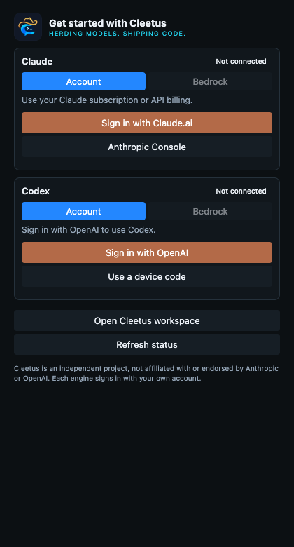

# Install and update Cleetus

**Available now:** [Cleetus IDE 0.2.0 for Apple Silicon](https://github.com/SnowBiz/cleetus-releases/releases/tag/ide-v0.2.0-macos-arm64) and the independent [VS Code extension 1.12.1](https://github.com/SnowBiz/cleetus-releases/releases/tag/v1.12.1). The Mac installer is signed and notarized; both releases include checksums.

_Read this guide on [cleetus.dev](https://cleetus.dev/docs/install/)._

Cleetus IDE includes the complete editor. If you need to stay in VS Code, use
the independently distributed extension. They have independent release and
update channels; installing one doesn't require the other.

For a terminal workspace or a headless Linux host, follow the separate [Cleetus CLI guide](CLI.md). CLI packages require Node.js 22+ and have their own `cli-v` release channel; they do not include an editor or a Node runtime.

## Install Cleetus IDE for Apple Silicon

Use an Apple Silicon Mac with macOS 12 or newer.

1. Open the [public releases listing](https://github.com/SnowBiz/cleetus-releases/releases), choose the latest stable **Cleetus IDE** release for Apple Silicon and download its `.dmg` plus `SHA256SUMS`.
2. Run `shasum -a 256 cleetus-ide-<version>-macos-arm64.dmg`, replacing `<version>` with the downloaded version, and compare the complete result with that filename's entry in `SHA256SUMS` from the same release.
3. Open the signed and notarized DMG and drag **Cleetus.app** to **Applications**.
4. Launch **Cleetus** from Applications, then open your project folder.

For a new setup, choose a release whose notes include the current native Claude
Code connection described in [Coding-agent connections](CODING_AGENTS.md).
Older SDK subscription-flow builds are retired from the recommended install
path. Use IDE 0.2.0 or extension 1.12.1 for the current native Claude Code flow.

When replacing an unsigned development app, macOS may request authorization for Cleetus’s existing Keychain item. Complete that system prompt locally to finish startup.

The IDE includes the editor, so you do not need VS Code or a source checkout. Its [Preview License](LICENSES.md) permits free personal and commercial use of the covered build. The [IDE guide](IDE.md) walks through Agent Command, teams, tasks, review and Design. Locally compiled unsigned development apps are separate from this installer.

For engine setup, install **Node.js 22+** and npm where your selected runtime
requires them, then follow the provider instructions below. You can use native
Claude Code, Codex, supported ACP agents or optional Claude API/cloud access; installing the editor does not install provider accounts or grant model access.

## Install the extension instead

Use **VS Code 1.94+**, Node.js 22+ and npm. The current clean-host engine-runtime audit covers macOS ARM64; other runtime platforms still need local verification.

1. Open the extension's independent [latest stable release](https://github.com/SnowBiz/cleetus-releases/releases/latest) and review its release notes.
2. Download `cleetus-<version>-universal.vsix` and `SHA256SUMS` from that release.
3. Verify the filename and full SHA-256 against `SHA256SUMS`.
4. In VS Code, open Extensions → **Install from VSIX…** and select the downloaded file. Alternatively, run `code --install-extension /path/to/cleetus-<version>-universal.vsix`.
5. Reload VS Code and open the Cleetus activity-bar icon.

Compute a checksum on macOS with `shasum -a 256 <file>`, on Linux with `sha256sum -c SHA256SUMS`, or in PowerShell with `Get-FileHash <file> -Algorithm SHA256`. A matching checksum establishes consistency with the downloaded release, not an independent publisher signature.

## Install the separate Claude runtime

This section is only for the optional **Claude API/cloud** engine. Native
Claude Code and ACP connections use their own installed CLIs and do not need
this SDK package. The SDK is not bundled in the VSIX or IDE. Use the pin matching
your release; the published runtime instructions use:

```sh
npm install --prefix "$HOME/.cleetus/runtime" --include=optional --omit=dev --no-audit --no-fund @anthropic-ai/claude-agent-sdk@0.3.312
```

PowerShell:

```powershell
npm install --prefix "$env:USERPROFILE\.cleetus\runtime" --include=optional --omit=dev --no-audit --no-fund @anthropic-ai/claude-agent-sdk@0.3.312
```

You can also download the public release repository as a ZIP and run `node docs/install-runtime.mjs`. Keep `install-runtime.mjs` and its adjacent `runtime-package.json` together. This installer uses only Node.js built-ins and npm; it does not require private source access.

Keep optional dependencies enabled: they supply the platform executable. The official Claude VS Code extension is unnecessary. A custom runtime location requires the same `CLEETUS_RUNTIME_DIR` environment variable when launching VS Code or Cleetus IDE.

## Connect your engines

Start with the [coding-agent connection guide](CODING_AGENTS.md). **Get started**
and **Agents** connect independently installed runtimes; installation does not
transfer provider credentials or grant model access.



- **Claude Code:** install your own CLI using [Anthropic's instructions](https://code.claude.com/docs/en/setup),
  then use the [guided Claude Code card](CODING_AGENTS.md#connect-your-own-claude-code).
  Sign-in, folder trust and initial MCP/channel consent stay in Claude Code's own
  browser or terminal flow. Enabling hosted Claude Code is a separate reviewed
  setting; channels remain off by default. Saved SDK conversations stay separate.
- **Copilot, Amazon Q / Kiro V3, Gemini, OpenCode, Kilo and other ACP agents:**
  install and sign in with the provider's native CLI, then connect its exact
  documented executable and arguments. Model access remains provider-owned.
- **Codex:** use its supported browser/device sign-in. Cleetus can use a configured
  executable, a suitable executable supplied by the official extension, or
  `codex` on PATH. A standalone CLI is needed if none is available.
- **Claude API/cloud:** use your own `ANTHROPIC_API_KEY` or supported cloud
  credential chain, such as a configured AWS region/profile for Bedrock.
  **Consumer Claude subscription sign-in through the SDK is not offered.**
  API-helper-only and ambiguous bearer-token gateway configurations are refused;
  enabling or disabling native Claude Code does not change that policy.

Provider access, billing and [Anthropic's hosting conditions](https://code.claude.com/docs/en/legal-and-compliance)
still apply. Native channels remain a maintainer-controlled preview; a Cleetus
release is not an Anthropic endorsement or production channel approval.

Open a project, then choose **Cleetus: Open Workspace** or **Cleetus: Open Studio**.
Start with a bounded task, inspect tool requests and diffs, and run relevant checks.

## Your Cleetus account

Choose **Account** in Studio or the native title bar, or run **Cleetus: Account and
Membership** in VS Code. Your system browser handles Cleetus sign-in. The host
keeps refresh credentials in secure storage; cached membership is display-only
and cannot grant paid access. Existing free and offline features stay available.
This account does not sign you in to a coding-agent provider or supply model
subscriptions. See [your Cleetus account](ACCOUNTS.md).

## Optional LAN collaboration

Both computers need a build with collaboration support: extension 1.11.2 or later, or Cleetus IDE 0.1.0. Each person needs an existing local team and **OpenSSL on PATH**; `openssl version` must succeed. Both computers must share the same directly attached private IPv4 subnet. Start no network listener until you choose **Collaborate on LAN** and approve it. Follow the [pairing and proposal guide](COLLABORATION.md); there is no automatic discovery or reconnect.

## Updates

In ordinary VS Code, these update controls install the extension VSIX. In Cleetus IDE, **Check for Updates** checks the independent native release channel. A verified notarized IDE installation can stage and recheck a signed installer from the same publisher before you explicitly open it. Unsigned development builds offer release notes only; the updater never replaces the app silently or bypasses Gatekeeper. For manual installation, choose the latest stable IDE in the [public releases listing](https://github.com/SnowBiz/cleetus-releases/releases) and verify its installer against that release's `SHA256SUMS`.

If you installed 1.10.0 or earlier, manually install 1.10.1 or newer once. Older builds check the former release location; they cannot discover releases after its source repository became private. Subsequent updates use this public download repository.

Update checks are enabled by default. About five seconds after startup, Cleetus checks its public release channel and prompts when a newer version is available: the IDE checks native installers, while the VS Code extension checks VSIX releases. Successful automatic checks are limited to once per day. Run **Cleetus: Check for Updates** at any time to bypass that interval, or disable **checkForUpdates** in Settings → Extension preferences. Offline checks do not block startup or install anything.

Choose **Release notes** to review the release, or explicitly choose **Download & install**. Cleetus verifies the versioned VSIX's size and SHA-256 before asking VS Code to install it. Choose **Reload window** to activate the new version. It does not silently install updates. Draft/prerelease/incomplete releases and mismatched checksums are rejected.

Engine subscriptions, model usage and third-party services are separate costs. See [licensing](LICENSES.md) and [troubleshooting](TROUBLESHOOTING.md).
