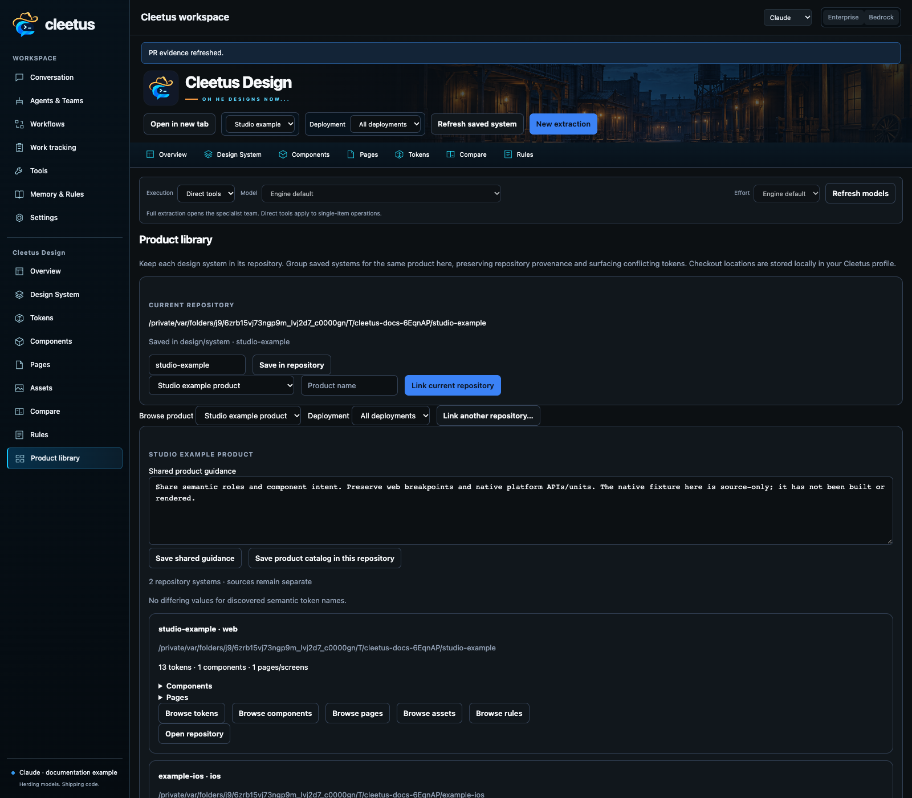

# Repository systems and product libraries

Save a design system with the repository that owns its implementation. Tokens, components, pages, assets, contracts, fixtures and rules belong in reviewable project files, not only an extension database.

A product library connects several repository systems for one product: for example, responsive web, iOS and watchOS, followed later by Android. Cleetus remains product agnostic; users supply their own repository/product identities.

## A practical workflow

1. Extract and curate each repository's design system.
2. Identify its deployments/platforms and register actual previews.
3. Link related checkouts into a product library.
4. Review shared token semantics, component roles, platform differences and rules.
5. Give agents the relevant implementation contract and repository context before adoption.
6. Commit intended project artifacts and review updates across affected repositories.

Machine checkout links are local. Portable library snapshots can be committed without absolute machine paths; relink the checkouts after cloning. A library does not automatically synchronize source, publish packages, rewrite consumers or erase platform differences.

Use impact/usage context before changing a reusable component. Review its stories and consuming pages, then explicitly update/test the applications that adopt it. This is how the library becomes reliable agent context rather than a stale file inventory.
