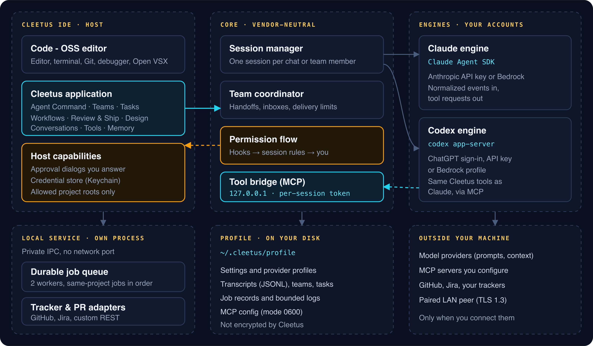

# How Cleetus works

[Use Cleetus in VS Code](VSCODE.md): keep your editor and add native Cleetus project, agent, crew and task views.

_Read this guide on [cleetus.dev](https://cleetus.dev/docs/)._

Cleetus is an agentic development environment: a Code - OSS editor with Claude and Codex agents, reviewable tasks and a design studio built in. These guides explain each feature the way you'd want a colleague to: what it does, how it works underneath, and exactly what it will and won't do on your behalf.

| Guide | What it covers |
| --- | --- |
| [Cleetus account](ACCOUNTS.md) | Sign in, manage membership and understand verified features |
| [Membership and saved settings](MEMBERSHIP.md) | Candidate Scout, Wrangler and Foreman resources, access checks and nonsecret cloud preferences |
| [Install and update](INSTALL.md) | Install the Apple Silicon IDE or a verified VSIX, set up separate engines, and update |
| [Personal account-host setup](ACCOUNT_HOST.md) | Candidate one-owner passkey enrollment, exact local review, status and offline stop; browser execution transport unavailable |
| [Cleetus CLI](CLI.md) | Terminal workspace, Linux headless host, installation, secure storage and service operations |
| [Cleetus IDE and Studio](IDE.md) | Native editor and Studio, goals/tasks, teams, workflow runs, owned worktrees and Design |
| [Workspace and conversations](GUIDE.md) | Chat, history, review, navigation, models and effort |
| [Connect coding agents](CODING_AGENTS.md) | Opt-in Copilot, Kiro V3, Gemini, OpenCode and custom ACP setup in builds with the connection command |
| [Phone control](PHONE_CONTROL.md) | Pair a trusted phone, review requests and reconcile interrupted operations |
| [LAN collaboration](COLLABORATION.md) | Pair two local teams over TLS 1.3 and review message/task proposals |
| [Prebuilt teams](TEAMS.md) | All nine teams, their purpose, setup and execution |
| [Cleetus Design](DESIGN.md) | Extraction, tokens, components, page review, assets and rules |
| [Preview adapters](ADAPTERS.md) | Real web stories, iOS/watchOS Simulator previews and platform requirements |
| [Product libraries](LIBRARIES.md) | Keep design systems in repositories and link systems across deployments |
| [Tools and integrations](TOOLS.md) | MCP assignment, local/container/hosted tooling and PR checks |
| [Work tracking](WORK_TRACKING.md) | GitHub Issues, Jira, custom tracker APIs and agent ownership |
| [Local service](SERVICE.md) | Background jobs, agent tools, recovery and host boundaries |
| [Encrypted headless CLI](HEADLESS_CLI.md) | Optional private D-Bus/keyring system service and safe code updates |
| [Licensing and distribution](LICENSES.md) | Apache components, free personal/commercial IDE preview terms and provider costs |
| [Troubleshooting](TROUBLESHOOTING.md) | Installation, account, preview, service and update problems |

## The short version

- **Everything runs on your machine.** Cleetus drives the Claude and Codex runtimes you install, signed in with your own accounts. Your profile, transcripts and task records stay in `~/.cleetus/profile`.
- **Agents ask; you decide.** Every edit, command and tool call goes through one permission flow, and team handoffs, imports and automation each have their own explicit approval.
- **Records are evidence, not claims.** Cards show saved state. A completed task, a green check or a "staged" receipt each mean one specific thing, and the guides say exactly what.
- **Nothing replays behind your back.** After a restart, interrupted work is marked interrupted. Cleetus never resends a remote write or restarts an agent turn on its own.

## Feature guides

| Guide                                                   | What you'll learn                                                                          |
| ------------------------------------------------------- | ------------------------------------------------------------------------------------------ |
| [Agent Command and conversations](GUIDE.md) | Give a goal, pick an engine, model and effort, follow a run, resume history                |
| [Agent teams](TEAMS.md)                             | Pipeline, parallel and supervised teams, the nine prebuilt crews, handoff tools and limits |
| [Tasks](TASKS.md)                                   | Acceptance criteria, fenced execution leases, dependencies and your review decision        |
| [Workflows and automation](WORKFLOWS.md)            | Saved DAGs, run journals and approved interval or event triggers                           |
| [Review & Ship](REVIEW.md)                          | Owned worktrees, tracked diffs and safe cleanup                                            |
| [Work tracking and PR evidence](WORK_TRACKING.md)   | GitHub Issues, Jira, custom REST trackers, atomic claims and head-bound PR checks          |
| [Encrypted LAN collaboration](COLLABORATION.md) | Pair two teams over pinned TLS 1.3 and exchange approved proposals                         |
| [Cleetus Design](DESIGN.md)                         | Extract a design system into your repo and refine real components                          |
| [Live previews](ADAPTERS.md)                        | Web sandboxes, iOS and watchOS in Simulator, product libraries                             |
| [Tools, MCP and approvals](TOOLS.md)                | Per-member MCP, developer tooling and the permission flow                                  |
| [Local service and agent jobs](SERVICE.md)          | Background jobs, ownership and recovery                                                    |
| [Product libraries](LIBRARIES.md) | Link the design systems of several repositories into one product |
| [Memory and rules](MEMORY.md)                       | `CLAUDE.md`, `AGENTS.md`, rules files and how they reach your agents                       |

## Under the hood

[Architecture](ARCHITECTURE.md) walks through a request from the chat to an engine and back. [Security model](SECURITY_MODEL.md) lists every trust boundary. To extend Cleetus with your own tools, commands, hooks or engines, see [Plugins and hooks](PLUGINS.md).

New here? [Install Cleetus](INSTALL.md), then take the [IDE tour](IDE.md). Stuck? See [troubleshooting](TROUBLESHOOTING.md). Licensing is in [licenses](LICENSES.md).

These guides are also published at [cleetus.dev](https://cleetus.dev/docs/). The native captures show an isolated CleetusGuide01 sample project with ready, unstarted members; no providers were started for them, and they don't demonstrate live account work or a physical two-computer LAN session.

## Activity and organization reporting

[Activity & diagnostics](OBSERVABILITY.md) explains local metadata, separate organization consent, installation approval, retention and reporting controls. Availability depends on your installed release and organization policy.
