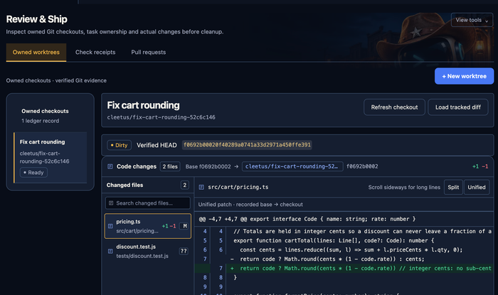
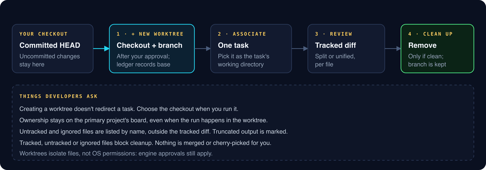
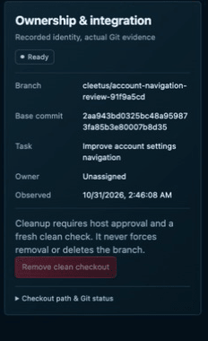

# Review & Ship

_Read this guide on [cleetus.dev](https://cleetus.dev/docs/review/)._

Review & Ship is where agent changes become code you're willing to merge. It gives each task its own **owned worktree**, shows the tracked diff against a recorded base, and only removes checkouts it can prove are clean.

## The flow

1. **Review & Ship → Owned worktrees → + New worktree.** After your approval, Cleetus creates a checkout and branch from your **committed HEAD** and records its base in a ledger. Uncommitted changes in your primary checkout stay there.
2. **Associate it with one task.** It then appears in that task's working-directory list.
3. **Run the task in it.** Choose the worktree as the working directory when you run. Creating it doesn't redirect anything automatically.
4. **Refresh checkout**, then **Load tracked diff.** Pick files from the changed-file list and switch between **Split** and **Unified**.
5. **Approve or request changes** on the task, then merge through your normal Git workflow.
6. **Clean up** when you're done.

## What the diff shows

- **Tracked changes** against the recorded base, as source-backed hunks.
- **Truncated output** is marked as truncated.
- **Untracked and ignored files** are listed by name, outside the tracked diff.
- **A dirty badge and verified HEAD** show exactly which commit you're looking at.

## Cleanup is conservative

**Remove clean checkout** needs your approval and a fresh clean check. Tracked, untracked or ignored files all block it, and **the branch is always kept**. Review & Ship never force-removes a checkout, deletes a branch, merges or cherry-picks.

## Boundaries worth knowing

- **Ownership stays on the primary board.** The task belongs to the primary project even when it runs in a worktree.
- **Authority doesn't transfer.** Another task's worktree, a changed Git identity or a stale lease grants no access, and history doesn't restore checkout authority by itself.
- **Worktrees isolate files, not permissions.** Engine approvals and OS permissions still apply.

## Task delivery packets

Open a task and choose **Review delivery packet** to bring its requirement, criteria, latest execution, owned checkout and check receipts into one view. The packet labels agent-reported claims separately from host-observed evidence. Each criterion still needs your review, and a check in the same workspace does not prove that the task or agent ran it.

The packet is a snapshot. Changed task revisions, execution records or checkout ownership stop preparation rather than silently combining old and new evidence. Refresh the task and open it again for current source. An old task approval has no recorded source digest and does not approve later changes.

Where the host supports it, **Export fresh JSON snapshot** opens the normal Save dialog. Export includes the task and project metadata shown in the packet; it creates a local review artifact. It does not upload, approve the task, merge a branch or publish a release. Review and approval continue through the task’s existing controls.

## Check receipts

**Review & Ship → Check receipts → Refresh check receipts** shows what your configured developer tools actually ran. Fixed CLI and container tools invoked through the Cleetus MCP connection create a local receipt before starting and a terminal receipt when the command exits. Refreshing the view never runs a check.

- **Passed** means Cleetus observed exit zero and the recorded source still matches.
- **Failed, timed out or cancelled** describes the observed command outcome.
- **Stale** means the source changed since that check.
- **Unknown** means completion or source identity could not be verified. Interrupted work is never rerun automatically.

Open **Inspect receipt** for its identity, Git HEAD, source digest and captured-output digest. Raw command output is not copied into the ledger. If capture was truncated, the digest only covers the captured portion.

The source fingerprint covers the worktree root, committed HEAD, staged identity and bounded tracked/untracked non-ignored file contents. Ignored files, external dependencies, environment and services are outside that scope. Unsupported source symlinks or submodules, hidden index flags, merge conflicts, missing source or oversized scans cannot produce a verified source pass. The snapshots do not prove that files never changed and reverted during a command.

These are local host observations, not signed remote attestations. Agent summaries, unrelated terminal commands and HTTP/SonarQube responses do not become current-source passes. A command's exit zero also does not prove that its tests are complete or that the feature meets your acceptance criteria. Review and release remain your separate decisions. The native IDE exposes this view; the shared VS Code extension preserves its developer-tool runtime and receipt support without importing the native-only interface.

## Pull requests

**Review & Ship → Pull requests** shows checks, reviews and merge evidence for each PR's current head, through a configured GitHub connection. Missing, skipped, stale and unavailable results stay distinct from a pass. If GitHub isn't configured, **Configure GitHub** takes you straight to setup. See [PR evidence](WORK_TRACKING.md#pull-request-evidence).

[Tasks](TASKS.md) · [Work tracking and PR evidence](WORK_TRACKING.md)

## Associate criteria with evidence

Open a task’s **Review delivery packet**, then choose **Associate evidence** for
a criterion. Select an actual current configured-check receipt and add a note
explaining its relevance. Cleetus asks you to review the exact criterion, receipt
result and source before saving the association. You can also associate a failed
check when that is relevant evidence; its result stays failed.

An owner association does not attest criterion satisfaction, claim that the task
ran the check or approve the task. Each criterion still requires your review.
Changes to the task revision, source, execution or receipt make prior associations
stale or unavailable. Original notes remain in local history and in fresh exported
packets. Unknown/stale checks cannot support a new current association.

If association storage needs repair, Cleetus preserves its records and treats
links as unavailable. Reviewing or exporting the packet does not start an agent,
rerun a check, merge code or publish a release.
