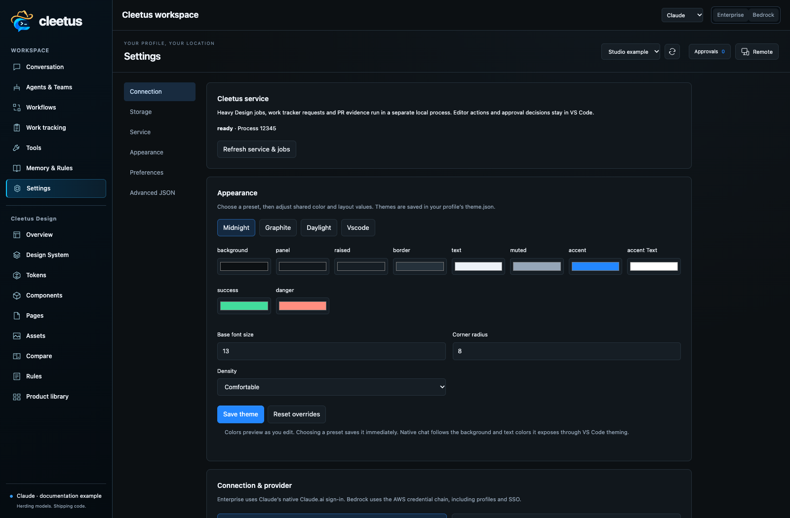

# Local service and agent jobs

Cleetus automatically starts a separate local service process. Tracker/PR requests and heavy Design work run outside the VS Code extension host. No additional service URL, account or shared agent token is needed.

Open Settings → **Cleetus service** and choose **Refresh service & jobs**. Inspect queued/running/completed/failed work or cancel a queued/running job. Two workers run concurrently by default, with same-project work serialized and a project lock protecting cross-window jobs.

## Let agents use it

Claude and Codex receive the same tools:

| Tool | Purpose |
| --- | --- |
| `cleetus_service_capabilities` | Discover supported operations and ownership rules |
| `cleetus_service_status` | Read service health |
| `cleetus_job_submit` | Queue a supported Design operation and return its job ID |
| `cleetus_job_list` | List the current session's jobs |
| `cleetus_job_get` | Inspect an owned job's progress/result/error |
| `cleetus_job_cancel` | Cancel an owned job |

Supported operations include extraction, site capture, source rendering, component extraction/creation/checking, capture, comparison and mock cropping. The host supplies the authenticated session and project; agents cannot choose another owner or inspect another session's job by guessing its ID. Normal tool permissions/hooks and the Design-tools setting remain effective.

Ask an agent to perform a background extraction, report its job ID and review the result. Job submission does not implicitly start a model/team. Design's **Extract from codebase** still provides the full reviewed extraction-team workflow.

## Recovery

Jobs retain durable state and bounded logs under the Cleetus profile. Cancellation preserves writes already made. On restart, unfinished records owned by a stopped service become interrupted, rather than replaying automatically. Inspect repository changes before retrying. Remote write timeouts need provider reconciliation because an operation may already have succeeded.

Reload VS Code if the service is unavailable. Closing the extension stops its owned service/jobs. The service is local user code, not an OS sandbox or remote multi-user control plane.

## Other hosts

Cleetus has a shared application and explicit host adapters so an independent client can reuse sessions, engine integrations and service tools. The current standalone browser developer host has partial UI parity. It is not a packaged/signed native IDE release, and no native IDE installer is implied by this guide.
