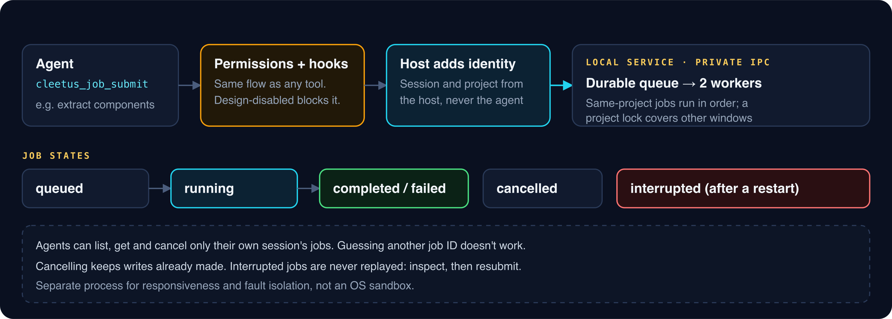

# Local service and agent jobs

**Release preparation:** this guide describes the proposed Cleetus IDE 0.2.0 platform. Check the [installation and release notes](INSTALL.md) for published downloads and the features in your installed build. IDE and extension releases remain independent.

_Read this guide on [cleetus.dev](https://cleetus.dev/docs/service/)._

Cleetus runs heavy and long-running work, such as tracker and PR requests and Design jobs, in a separate local service process. The editor stays responsive, a crash there can't take the editor down, and agents get a durable job queue they can submit to and check on.

## What it is

- **A separate Node.js process** started automatically by Cleetus, talking to the editor over a **private inherited IPC channel**. It opens no network port and needs no URL, account or shared token.
- **Two workers** by default. Jobs for the same project run in order, and a project lock covers other Cleetus windows on that project.
- **Durable records** with bounded logs, kept in your profile.

It runs with your user's privileges. Process separation buys responsiveness and fault isolation; it isn't an OS sandbox.

Open **Settings → Cleetus service** and choose **Refresh service & jobs** to see queued, running, completed and failed work, and to cancel a queued or running job.

## Let agents use it

Claude and Codex receive the same tools; connected ACP agents can receive them
when their negotiated MCP support and explicit assignments allow it:

| Tool                           | What it does                                          |
| ------------------------------ | ----------------------------------------------------- |
| `cleetus_service_capabilities` | Supported operations and ownership rules              |
| `cleetus_service_status`       | Service health                                        |
| `cleetus_job_submit`           | Queue a supported Design operation; returns a job ID  |
| `cleetus_job_list`             | This session's jobs                                   |
| `cleetus_job_get`              | Progress, result or error for a job this session owns |
| `cleetus_job_cancel`           | Cancel a job this session owns                        |

Supported operations include extraction, site capture, source rendering, component extraction, creation and checking, capture, comparison and mock cropping. Try: _"Run a background component extraction for `src/components`, tell me the job ID, and summarize the result when it finishes."_

## Ownership

The host, not the agent, supplies the session and project for every job. An agent can't name another owner, and it can't read or cancel another session's job by guessing its ID. Your management view is limited to jobs for currently authorized open projects;
cancellation needs host review and another ownership check. Agents never get
that broader management authority.

Submitting and cancelling go through the normal [permission flow](TOOLS.md#the-permission-flow), and turning off the Design tools setting blocks submissions. Job arguments still run real adapters, so source execution, network access and native builds behave as they would anywhere else.

## Recovery

Jobs retain durable state and bounded logs under the Cleetus profile.
Cancellation preserves writes already made. A stopped service retains
interrupted or uncertain work without automatically replaying it. Use the exact
cleanup states below to decide what needs inspection.

- A queued job can become **cancelled** immediately because no worker launched.
- Cancelling a running job first records **cancellation-requested**. The project
  stays occupied until its owned worker and process-group cleanup are confirmed.
  The service requests termination, then uses bounded forced cleanup if needed;
  only confirmation allows the job to become **cancelled**.
- If termination cannot be confirmed, **cleanup-required** retains an explicit
  uncertain result and blocks new service jobs for that project. A previously
  running or cancelling job left by a stopped service also requires this review;
  a never-launched queued job becomes **interrupted**. Cleetus neither replays
  the work nor kills an arbitrary process from a saved PID after restart.

For **cleanup-required**, inspect the retained job/error, confirm its owned work
has stopped and reconcile repository changes before manual recovery. The fence
is not removed automatically. A late worker reply cannot turn a cancellation
request into a successful result. Closing the host awaits bounded owned cleanup;
if confirmation fails, the uncertainty record remains.

Damaged saved Design JSON is preserved and blocks replacement extraction writes.
A damaged session-history index is also preserved rather than replaced with an
empty index. These recovery errors require repair or a
reviewed restoration; Cleetus does not silently delete or rebuild the originals.
See [workflow and saved-data recovery](TOOLS.md#workflow-execution-and-recovery).
Remote write timeouts still need provider reconciliation because an operation
may already have succeeded.

Reload VS Code if the service is unavailable. Closing the extension requests
cleanup of its owned service/jobs; use the recorded state to distinguish
confirmed cleanup from uncertainty. The service is local user code, not an OS
sandbox or remote multi-user control plane.

[Cleetus Design](DESIGN.md) · [Work tracking](WORK_TRACKING.md) · [Architecture](ARCHITECTURE.md)
