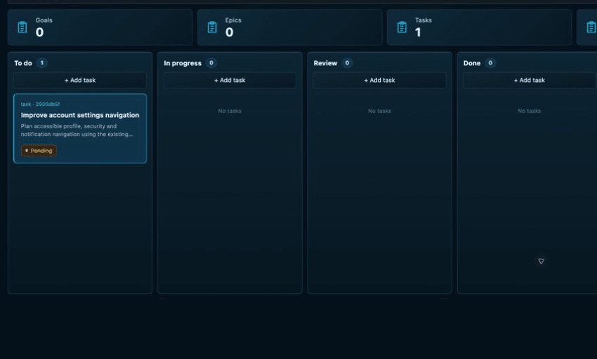
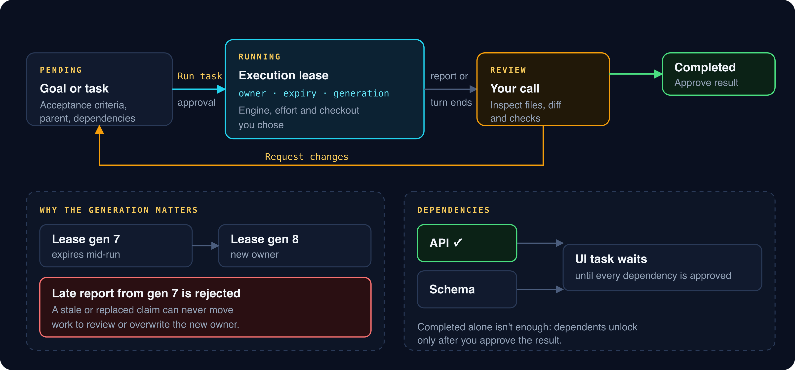
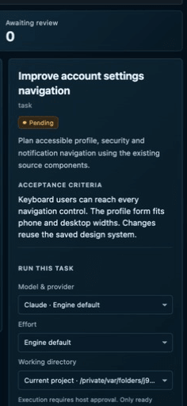

# Tasks

_Read this guide on [cleetus.dev](https://cleetus.dev/docs/tasks/)._

Tasks turn "go do this" into work you can audit. Each goal or task has acceptance criteria, an owner, an execution record and a report, and it's complete only when **you** approve the result.

## The lifecycle

| State         | Means                                         | Moves on when                                        |
| ------------- | --------------------------------------------- | ---------------------------------------------------- |
| **Pending**   | Recorded, with criteria and dependencies      | You choose **Run task** and approve it               |
| **Running**   | An engine is working under an execution lease | The agent reports, or its turn ends                  |
| **Review**    | Work is waiting for your decision             | You choose **Approve result** or **Request changes** |
| **Completed** | You approved the result                       | —                                                    |

**Request changes** sends the task back to pending with your reason recorded, ready to run again. Completion is always your decision: Cleetus never marks work done because a turn ended or checks passed.

## Create and run a task

1. **+ New goal** or **+ New task**. Give it a title, description, acceptance criteria and a parent goal if it belongs to one.
2. Select the card. The inspector shows ownership, execution and report.
3. For a pending task, choose the engine and model, the effort and the **working directory**, then **Run task** and review the approval.
4. Follow the execution receipt. **Stop execution** interrupts the agent if needed.
5. When it reaches review, inspect the actual files, diff and checks before deciding.

The working directory list holds your project plus any ready [owned worktrees](REVIEW.md) associated with **this** task. Creating a worktree doesn't redirect a task by itself; you pick it when you run.

## Execution leases and fencing

Ownership is a lease with an owner, an expiry and a **fencing generation**: a number that goes up every time ownership changes hands.

When a lease expires or is replaced, the new owner gets a higher generation. A late report from the old one carries a stale generation and is rejected, so a slow or zombie agent can never move work to review or overwrite the current owner. The same rule protects [tracker claims](WORK_TRACKING.md#claims-and-fencing).

## Dependencies

A task can depend on others. It can't be claimed until **every** dependency is completed **and** approved; a finished but unreviewed dependency still blocks. This keeps a team from building on work nobody has checked.

## Tasks from other places

- **Agent Command** saves your goal and a linked execution task before running.
- **Work tracking** can prepare a task brief from a GitHub or Jira issue. See [Work tracking](WORK_TRACKING.md).
- **LAN collaboration** imports approved proposals as pending tasks with external provenance. See [Encrypted LAN collaboration](COLLABORATION.md).

Tasks always belong to the primary project's board, even when the run uses a worktree. Concurrent edits are revision-checked: if the board changed since you loaded it, your stale action is rejected instead of silently applied.

[Workflows](WORKFLOWS.md) · [Review & Ship](REVIEW.md) · [Agent teams](TEAMS.md)
