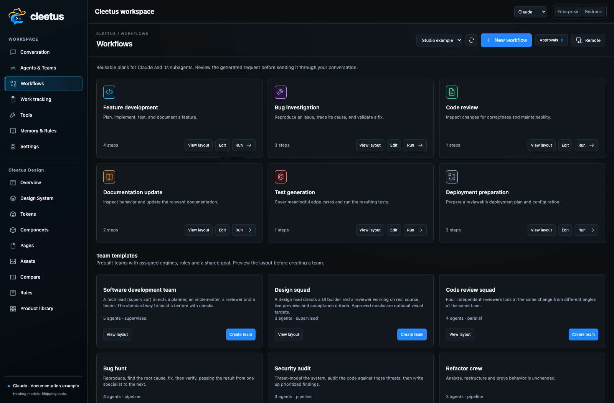
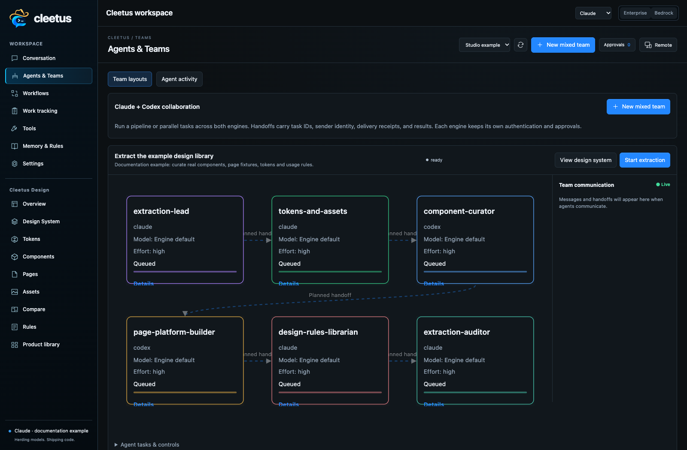

# Choose and run a prebuilt team

Prebuilt teams give a shared goal to agents with defined roles, detailed system prompts, and an execution plan. They use the same Claude/Codex engines as ordinary conversations. Choose a template in **Workflows → Team templates**, inspect **View layout**, and choose **Create team** when it fits your task.

A workflow recipe is lighter: it prepares a reusable request for one conversation and lets that engine decide how to delegate. A mixed team is scheduled by Cleetus, with explicit member identities, reports, messages, and handoffs.

## Which team should I choose?

| Team | Choose it when… | Members and execution | Example goal |
| --- | --- | --- | --- |
| **Software development team** | Building a feature across planning, implementation, review, and tests. | Supervised: Claude tech lead directs a Claude planner, Codex implementer, Claude reviewer, and Codex tester. | “Add account notification preferences, preserve existing defaults, and test save/error behavior.” |
| **Design squad** | Implementing or refining UI using the saved design system and approved references. | Supervised: Claude design lead directs a Codex UI builder and Claude design reviewer. | “Refine the account settings block, reuse its tokens, and review all consumers at mobile and desktop widths.” |
| **Design System Extraction** | Building or hardening the design library from existing source or a permitted website. | Pipeline: Claude discovery lead → Claude tokens/assets → Codex component curator → Codex page/platform builder → Claude rules librarian → Claude auditor. | “Extract this repository's design system, register real previews, and report unresolved runtime coverage.” |
| **Code review squad** | Reviewing an existing change from several perspectives without assigning a feature build. | Parallel: Claude correctness/security reviewers and Codex test/maintainability reviewers. | “Review the current diff for authorization defects, regressions, missing tests, and maintainability concerns.” |
| **Bug hunt** | Reproducing and fixing a concrete defect with an independent verification stage. | Pipeline: Codex reproducer → Claude root-cause analyst → Codex fixer → Claude verifier. | “Reproduce the lost form state after navigation, fix its cause, and verify the original reproduction.” |
| **Security audit** | Investigating the code's security risks and producing a prioritized report. | Pipeline: Claude threat modeler → Codex code auditor → Claude security reporter. | “Audit file uploads and tenant boundaries; include concrete code evidence and remediation priorities.” |
| **Refactor crew** | Improving structure while preserving behavior. | Pipeline: Claude analyst → Codex refactorer → Claude regression checker. | “Separate persistence from UI logic without changing behavior; demonstrate existing checks still pass.” |
| **Docs and research** | Investigating repository behavior, writing documentation, and checking its claims. | Pipeline: Claude researcher → Claude writer → Codex fact checker. | “Document installation and provider configuration with commands checked against this repository.” |
| **Lean pair (cost-efficient)** | A small, well-defined implementation with a separate review. | Pipeline: Codex implementer → Claude reviewer; Low effort preset. | “Add the missing empty-state message and review the diff for regressions.” |

These are starting roles, not guaranteed outcomes or fixed vendor/model requirements. Inspect the actual template before starting; saved template edits can change its settings. Security reviews are code investigations, not certifications. Detailed roles and tool permissions remain important even when all members use the same engine.

## Configure and start

1. Open the target project and connect the engines you intend to use.
2. Select the template and write a concrete goal: desired behavior, scope, constraints, and acceptance checks.
3. Inspect the workflow mode and each member's role, task, system prompt, engine, model, effort, and MCP access.
4. Keep engine-default models or choose available catalog models. Whole-team choices are grouped by engine/backend; individual members can override them. A supervised team requires a Claude supervisor.
5. Set team effort and any per-agent overrides. Blank per-agent effort inherits the team setting. Extraction recommends High; the lean pair presets Low. Other templates can have their own member settings.
6. Create the team and start its workflow. Extraction offers **Create & start extraction** or **Create without starting**.
7. Review messages, approvals, output, reports, and actual artifacts in **Agents & Teams**.

Agent details in a template layout let you inspect and save its model, effort, system prompt, and MCP settings. Ready-team agent settings can also be edited before launch; started agents cannot be reconfigured through that pre-start editor. Refresh/reopen when another window has changed the saved settings.

## Understand the execution mode

- **Pipeline:** stages run in order. An explicit completed report hands results to the next stage. An ended turn without that report pauses for review.
- **Parallel:** members run independently in the same working tree. Divide file ownership or use separate worktrees where necessary.
- **Supervised:** only the Claude supervisor starts initially. It assigns work, starts members, reviews results, and reports back. Use its message controls to give direction.

Use **Output** to inspect actual work, **Message** to provide direction, and approval controls to answer tool requests. A blocked member needs a concrete recovery action. **Accept & hand off** is your explicit review decision; use it after inspecting the result. Stop a team to interrupt its agents. Delivery limits prevent unlimited task/message loops.

Ready teams can be reopened for editing. Running scheduling is window-local and does not automatically restart after a reload; saved records are not proof of a resumed workflow. See the [service and recovery guide](SERVICE.md) for exact handoff, failure, and cancellation behavior.

## Design squad or extraction team?

Use **Design System Extraction** to discover and curate what the product already has: tokens, assets, composed components, pages, platform fixtures, contracts, and rules. Starting from Design fills the repository/scope into normal team setup. Its **View design system** action returns to that project's saved artifacts.

Use the **Design squad** to implement or refine an interface against those decisions and approved references. A component/page studio task can prepare a focused team or Conversation draft with source, fixtures, contracts, rules, and acceptance criteria. Preparing a draft does not send it or start agents automatically.

[Design extraction](DESIGN.md#extract-your-first-design-system) · [Component refinement](DESIGN.md) · [Workspace operations](GUIDE.md)
