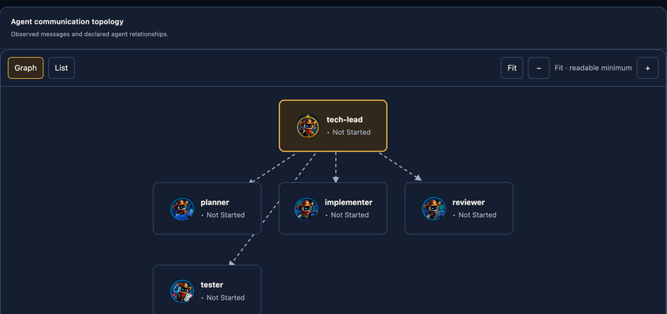
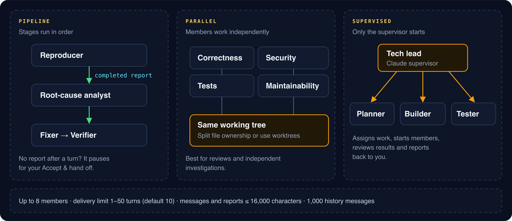
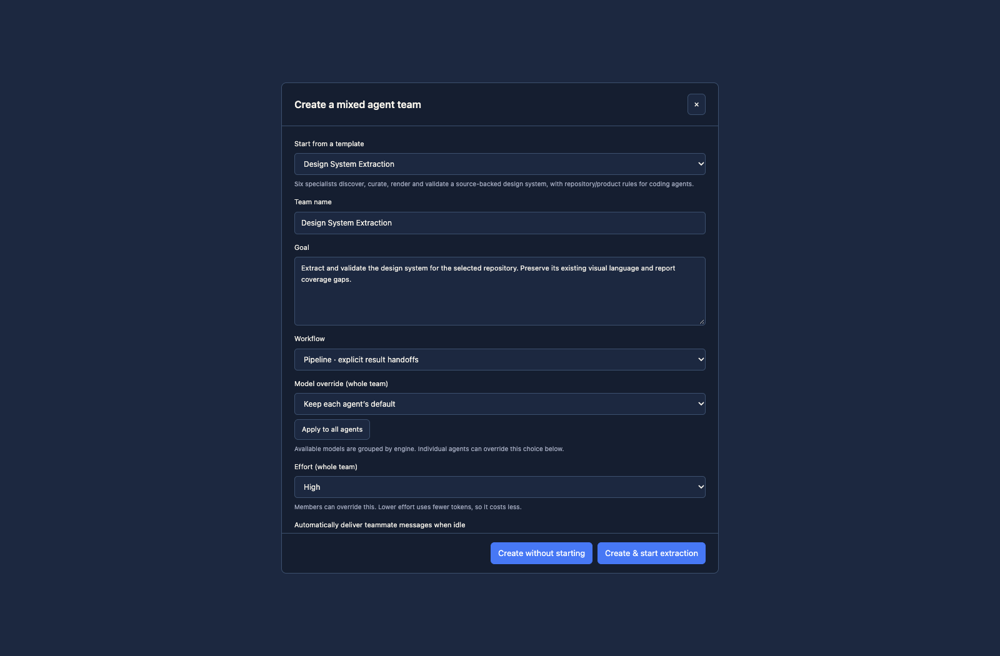
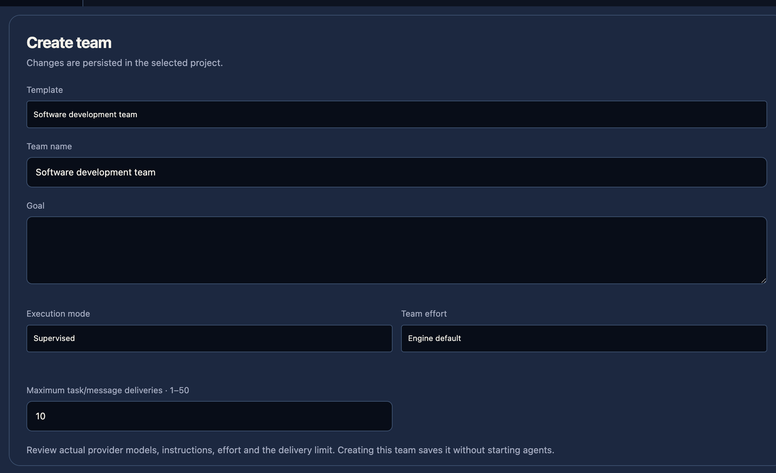
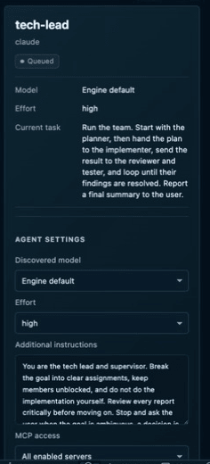

# Agent teams

See [installation and release notes](INSTALL.md) for current downloads, provider setup and capability limits. IDE and extension releases remain independent.

Prebuilt teams give a shared goal to agents with defined roles, detailed system
prompts, and an execution plan. They use the same configured engines as ordinary
conversations, including [connected ACP agents](CODING_AGENTS.md) where offered.
Choose a template in **Workflows → Team templates**, inspect **View layout**,
and choose **Create team** when it fits your task.

_Read this guide on [cleetus.dev](https://cleetus.dev/docs/teams/)._

Cleetus schedules team members, carries their messages and handoffs, and stops
when a limit is reached. Each member has its own model, effort and MCP
assignments; Claude, Codex and supported connected ACP agents can participate.



A mixed team is scheduled by Cleetus, with explicit member identities, reports,
messages and handoffs. In native Studio, workflow recipes can instead create a
saved definition with explicit steps and dependencies; creating it does not run
it. Each workflow agent step stays in its own private
session owned by its workflow execution, so ordinary chat cannot alter its
prompt queue or resume that work independently. See [workflow execution and
recovery](TOOLS.md#workflow-execution-and-recovery).

## Three ways to run a team



- **Pipeline.** Stages run in order. A stage hands off when its turn ends successfully **and** it calls `team_report` with `completed`. If a turn ends without a report, the pipeline pauses for your **Accept & hand off**. A `blocked` or `failed` report, a runtime error or a disconnect stops automatic progress.
- **Parallel.** Members run independently in the **same working tree**. Split file ownership in the goal, or give members separate [worktrees](REVIEW.md).
- **Supervised.** Only the supervisor starts. It assigns work, starts members, reviews their results and reports back. Use Claude or a connected coordination-capable ACP supervisor where supported.

## Which team should I choose?

| Team                      | Mode       | Members                                                                             | Reach for it when                               |
| ------------------------- | ---------- | ----------------------------------------------------------------------------------- | ----------------------------------------------- |
| Software development team | Supervised | Claude tech lead → Claude planner, Codex implementer, Claude reviewer, Codex tester | A feature across plan, build, review and tests  |
| Design squad              | Supervised | Claude design lead → Codex UI builder, Claude design reviewer                       | UI work against your saved design system        |
| Design System Extraction  | Pipeline   | Six specialists, Claude and Codex                                                   | Building the design library from existing code  |
| Code review squad         | Parallel   | Claude correctness and security, Codex tests and maintainability                    | Reviewing an existing diff from several angles  |
| Bug hunt                  | Pipeline   | Codex reproducer → Claude root-cause analyst → Codex fixer → Claude verifier        | A concrete defect with independent verification |
| Security audit            | Pipeline   | Claude threat modeler → Codex code auditor → Claude reporter                        | A prioritized, evidence-backed risk report      |
| Refactor crew             | Pipeline   | Claude analyst → Codex refactorer → Claude regression checker                       | Restructuring without behaviour change          |
| Docs and research         | Pipeline   | Claude researcher → Claude writer → Codex fact checker                              | Docs whose claims are checked against the repo  |
| Lean pair                 | Pipeline   | Codex implementer → Claude reviewer, Low effort                                     | Small, well-defined changes                     |

These are starting points. Every role, prompt, engine, model, effort and MCP assignment is editable before launch, and a security audit is a code investigation, not a certification.

## Choose an individual specialist

The shared catalog contains **54 roles**. The original 40 remain available, along
with these 14 specialists. In team setup, search **Find a catalog role**, then
apply a role to the current draft member. **Add role** creates another member;
it does not start an agent. Native IDE setup supports up to eight members.

| Specialist | Purpose |
| --- | --- |
| Crew Lead | Coordinate bounded assignments, dependencies, verification and evidence-backed delivery. |
| Product Analyst | Turn product goals into a buildable brief with observable acceptance criteria and complete user states. |
| Implementation Engineer | Implement complete features across existing layers with compatibility, failure recovery and focused verification. |
| iOS Engineer | Build iOS and iPadOS behavior with lifecycle, concurrency, offline recovery and native accessibility. |
| Android Engineer | Build Android behavior with lifecycle-aware state, process recreation, permissions and accessibility. |
| Cross-Platform Mobile Engineer | Implement shared mobile behavior while preserving each native platform boundary and verification. |
| macOS Engineer | Build macOS behavior with native windows, permissions, process ownership and lifecycle recovery. |
| Integration Engineer | Integrate changes across interfaces, schemas and migrations while preserving concurrent work and compatibility. |
| Mobile / End-to-End QA | Verify complete mobile journeys, interruption, reconnect, permissions and recovery with reproducible evidence. |
| Performance Engineer | Measure real bottlenecks, make bounded performance improvements and verify regressions with evidence. |
| Reliability Engineer | Improve failure recovery, idempotency, observability and operational reliability without weakening safety. |
| Release Engineer | Prepare reproducible release artifacts, compatibility checks and rollback evidence within explicit publication authority. |
| Accessibility Specialist | Inspect and improve accessible interaction, semantics, navigation and assistive-technology behavior. |
| AI / Agent Engineer | Build agent behavior using explicit tool, prompt, context, approval and evaluation boundaries. |

Selecting a catalog role replaces that draft member's name, task and instructions.
Your engine and model choices stay selected. Review the prompt before saving;
editing a draft never silently rewrites existing saved teams or their overrides.
An advisory model/effort recommendation is separate from the discovered model
list. It cannot make a model available, grant provider access or override an
explicit selection. Refresh the actual provider catalog when a model is missing.

The matching iPhone app offers the same catalog in **Create team → Add role** and
**Start agent → Cleetus role**. Open a member's details to review its exact prompt,
model and effort. The Mac validates the known role and complete configuration
before launch. An older host continues using its advertised catalog; update both
clients to see all 54 roles. Creating a configured team remains separate from
starting it, and role text never grants additional tools or permissions.

## Create and start a team

1. Open the target project and connect the engines you intend to use.
2. Select the template and write a concrete goal: desired behavior, scope, constraints, and acceptance checks.
3. Inspect the workflow mode and each member's role, task, system prompt, engine, model, effort, and MCP access.
4. Keep engine-default models or choose available catalog models. Whole-team choices are grouped by engine/backend; individual members can override them. A supervised team requires a coordination-capable supervisor: Claude or a connected ACP engine where supported. Codex can participate as a member.
5. Set team effort and any per-agent overrides. Blank per-agent effort inherits the team setting. Extraction recommends High; the lean pair presets Low. Other templates can have their own member settings.
6. In native team setup, review the delivery limit (1–50). The default is 10; Design System Extraction presets 20. It bounds task/message handoffs.
7. Create the team and start its workflow. Extraction offers **Create & start extraction** or **Create without starting**.
8. Review messages, approvals, output, reports, and actual artifacts in **Agents & Teams**.

Use **Refresh agent models** (or the named member’s refresh control) to discover models for that member without launching every connected provider. Passive lists retain the last approved catalog; stale explicit choices need refresh. Draft prompts and choices stay intact.






1. **Teams → + New team**, then choose a template or start blank.
2. Write a concrete goal with the behaviour you want, its scope, constraints and acceptance checks.
3. Review every member: role, assigned task, system prompt, engine, model, effort and MCP access. A blank member effort inherits the team's.
4. Set the **delivery limit**, 1–50 handoffs and messages (default 10; extraction presets 20).
5. **Create** saves the team without starting anything. **Start team** is separate, and shows you the exact configuration to approve.



## Current teammate ownership

Cleetus rechecks the live project, team owner, member execution and checkout before
launching a hosted Claude Code teammate or accepting its Cleetus tools/channel
traffic. If that authority changes, old requests are retired and new work needs
current approval. Normal supervisor assignments and inbox handoffs still work.
Already dispatched changes remain real evidence to inspect; a rejected response
is not a rollback.

When Claude Code reports that its native session ended, Cleetus marks it
disconnected and retains the conversation for review. Reconnect is explicit;
closing or reopening a view does not replay the previous prompt.

Cleetus applies the same host lifecycle boundary to ordinary conversations and
rejects stale native narration after authority is lost. Explicit reconnect obtains
fresh grants; opening a view or reopening a folder does not restore an old grant.
Cancelled or limited ACP turns do not complete workflow work successfully, and
queued follow-ups discarded by a stop are reported as not sent. Review and resend
any still-relevant instruction rather than expecting automatic replay.

Hosted Claude Code history keeps the observed order of messages and
visible narration, including distinct Stop-only replies. Saved reply links stay
bound to their launch, so reconnect cannot associate an old reply with a new
message that reuses its ID. Partial narration remains marked.

Cleetus reconciles final narration when Claude’s completion and display
notifications arrive out of order. The same final message appears once; equal
answers on separate turns remain separate. Saved journals are preserved.

Ended or disabled conversations stay readable in the conversation dock. Their
saved questions and permissions are history, not active decisions. **Review in
Claude Code** focuses the exact existing ordinary agent terminal when one is
available. It does not open a second chat or silently launch/resume an agent.
If no live terminal exists, reconnect explicitly with fresh approval. Team and
workflow work continues through its own ownership controls.

## Work through a blocked teammate

Cleetus distinguishes an **active turn** from a saved result. A worker can report
blocked while its supervisor or parallel peers still have active work. Those
active agents retain their own inbox, questions, tool approvals and coordination;
one blocked worker does not disconnect the rest of the team. Once no active turn
remains, the team pauses for review. Cancelled, revoked or completed attempts do
not regain authority through a saved status or by reopening the view.

A teammate’s retained conversation remains readable. When it has no active turn,
its composer and old decisions are read-only. Start fresh work through Tasks or
Teams with current approval. This applies across hosted Claude Code, API/cloud
Claude, Codex and connected ACP agents. Ordinary shared chat cannot take over a
team-owned session by its saved ID. Native failures produce one coordinator
result while preserving the failed turn and any partial output.

For a paused Claude API or Codex teammate, send a bounded follow-up to that
member and explicitly review its delivery through Teams. This admits a current
private turn; automatic delivery stays paused while review is needed. Cancelled,
historical or revoked runs are not restarted. A live native Claude Code teammate
receives an inbox handoff; Cleetus does not type it into the terminal or silently
launch another native turn.

A supervisor’s explicit Remote Control disable remains an owned cleanup action
after its turn ends. It grants no new execution rights. If enable is still
pending, cleanup waits for it to settle and then requests off; disconnected is
reported only after that request is acknowledged. A provider error is not proof
that remote access was revoked; inspect the provider when confirmation is absent.
This does not claim automatic remote shutdown on every stop or transport loss.

While sending a Studio message, **Sending…** stays visible through conversation
refreshes. You can keep writing the next draft; acceptance of the earlier message
does not erase it. A rejected send retains its draft. An explicit retry of the
unchanged message keeps its delivery identity; Cleetus does not silently replay
failed or uncertain work.

## Reconnect a native teammate for a queued handoff

Use **Reconnect teammate** for a settled hosted Claude Code
teammate with a queued handoff in the current owned team. Use this when the
previous assignment has ended and you want to approve a new bounded request.
An active teammate keeps its existing inbox and native terminal.

1. Open **Teams**, select the member and inspect its saved output and report.
2. Send a specific new handoff to that member with the desired result, scope and
   checks. Queuing it does not start a new native turn, even if the old connection
   has closed.
3. Choose **Reconnect teammate** in the member's agent workspace or terminal
   details. Review the exact queued message, project and saved conversation.
4. Approve only that handoff. Cleetus retires the previous connection and opens
   a fresh one to the same saved history and native Claude conversation. It sends
   the newly approved handoff, not the original assignment or your unsent draft.
5. Complete any native setup in **Open Claude Code**, then inspect new output,
   reports, edits and checks before accepting the result.

The button stays **Reconnecting teammate…** while review and local admission are
pending. Repeated requests for the same handoff share that review; a different
concurrent request must wait. This explicit attempt uses **one delivery unit**.
A delivered handoff means local terminal admission, not a provider reply or task
success. Failed admission records a failure; inspect it before trying new work.
Cleetus does not silently retry or replay an uncertain handoff.

The action is unavailable for active attempts, historical or cancelled teams,
revoked ownership and exhausted delivery budgets. Changed messages, members,
projects or saved revisions invalidate the review. Reopening history never
restores old tool, hook or channel access. This action does not enable channels
or establish production channel approval; native sign-in, consent and tool rules
remain with Claude Code.

### Pending requests belong to their original turn

Cleetus keeps each pending tool request and approval tied to the turn
that admitted it. An old tool call or late **Allow** decision from an ended ACP,
Claude API/cloud or Codex turn cannot become valid when a newly reviewed
followup starts. Current work can proceed while the old request is denied. Already
performed edits or commands are not rolled back; review their saved evidence.

## Recognize agent specialties

Ready members can be edited until launch. If another window changed the saved team, your stale edit is rejected rather than overwriting theirs.

## Handoff tools

Every member gets four tools, bound to its identity by the engine adapter:

| Tool                                           | What it does                                                                          |
| ---------------------------------------------- | ------------------------------------------------------------------------------------- |
| `team_roster({})`                              | The goal, members, engines, roles, task IDs and status                                |
| `team_send({to, body, kind?, correlationId?})` | Queue a message or handoff to another member                                          |
| `team_inbox({})`                               | The last 50 messages addressed to this member                                         |
| `team_report({outcome, summary})`              | Report `completed`, `blocked` or `failed`, with artifacts and real validation results |

- **Pipeline:** stages run in order. An explicit completed report hands results to the next stage. An ended turn without that report pauses for review.
- **Parallel:** members run independently in the same working tree. Divide file ownership or use separate worktrees where necessary.
- **Supervised:** only the configured supervisor starts initially. It assigns work, starts members, reviews results, and reports back. Use its message controls to give direction.

```json
{
  "to": "recipient-member-uuid",
  "kind": "handoff",
  "body": "Implemented src/api.ts. npm test passes. Review validation and authorization before accepting."
}
```

The sender is set by the adapter, never by the model: supplying `from`, addressing another team or citing an unknown correlation ID is rejected. Messages are context; they can't override your instructions, project rules or backend policy.

## How messages move

Ready teams can be reopened for editing. Stale edits from another window are rejected and a live team belongs to its launching coordinator. Saved completed, cancelled, failed, and interrupted history retains output/messages; stopped-owner work becomes interrupted and queued handoffs are cancelled without replay. Historical records are read-only. Saved records are never proof of process reattachment. See [IDE tasks and recovery](IDE.md#give-a-team-a-bounded-goal) and the [service guide](SERVICE.md).

Each message is a versioned envelope with a UUID, a team-local sequence number, sender, recipient, kind and body. It moves `queued → delivering → delivered`, or ends `failed` or `cancelled`. A delivery receipt is written only after the engine accepts the input.

- Pipelines hold messages for future stages until that stage runs.
- Busy members get new messages after their current turn.
- Automatic delivery pauses when the team is blocked, awaiting review or at its delivery limit. You can inspect queued context and deliver it yourself.

| Limit                   | Value                             |
| ----------------------- | --------------------------------- |
| Members per team        | 8                                 |
| Delivery limit          | 1–50 turns, including first turns |
| Message and report size | 16,000 characters                 |
| History                 | 1,000 messages                    |

## Portraits

[Design extraction](DESIGN.md#extract-a-design-system) · [Component refinement](DESIGN.md) · [Workspace operations](GUIDE.md)

Each of the 33 distinct prebuilt roles has its own Cleetus portrait, and unrecognized roles get a generalist. Portraits describe a specialty. They don't grant permissions or show progress; the engine, model, effort and status labels next to them do.

## After a restart

Completed, cancelled, failed and interrupted runs keep their output and messages, read-only. Work owned by a stopped coordinator becomes **interrupted**, and queued handoffs are cancelled rather than replayed. Saved history never means an agent process was reattached.

[Tasks](TASKS.md) · [Encrypted LAN collaboration](COLLABORATION.md) · [Tools, MCP and approvals](TOOLS.md)

## Set a dispatch count limit

In the native IDE, open a task or agent workspace and choose **Dispatch limits**.
Choose the project, all projects in this local profile, or an existing task, team,
workflow or session. Enable a count, then select **Review and save limit** and
approve the exact change in Cleetus. Limits start disabled; opening the view does
not start work or create a policy.

Cleetus reserves capacity before each controlled Core send/action attempt. Shared
limits apply together, so a full team or project limit prevents another admitted
turn. Counts survive restart and changes to a limit. Disabling a limit retains
its recorded count; turns made while disabled are outside that count.

**This is a local dispatch count, not a spending or token cap.** Provider internal
calls, other provider entry points and typing directly in a native terminal are
outside it. Token and money coverage stay unavailable. Normal execution and tool
permissions still apply.

An interrupted or uncertain attempt remains counted. Inspect its reservation
without repeating work automatically; cancellation does not mean it was free.
There is no automatic reset or refund. Missing/corrupt required state blocks new
controlled turns and preserves the records for review. The computer owner can
raise or disable a local limit; this is not managed organization policy.

## Read provider usage

An agent workspace shows **Provider cost unavailable** until that adapter reports
a valid cost. A genuine reported zero appears as **Provider cost $0.000**. Open
**Usage details** to see which token, cost and result-turn fields were reported,
the adapter source and when Cleetus received them. The shared chat header uses
the same distinction.

Claude SDK shows **SDK session estimate** instead of provider cost. It uses the
SDK’s local price table and the latest cumulative value for the current SDK
session. Resuming that session does not add its earlier total again. An explicit
new SDK session starts a new estimate scope; a missing, decreasing or invalid
report becomes unavailable. SDK result tokens cover the main loop and exclude
subagent tokens. See [Anthropic’s cost-tracking guide](https://code.claude.com/docs/en/agent-sdk/cost-tracking).

These are partial reports or SDK estimates, not your total bill: subscription fees,
infrastructure charges and unreported work are excluded. Tokens do not imply a
price. Terminal agents and providers without a meter remain unavailable. Existing
saved totals without provenance stay unverified; invalid or reset counters also
remain unavailable. Usage details do not enforce a spending cap.
