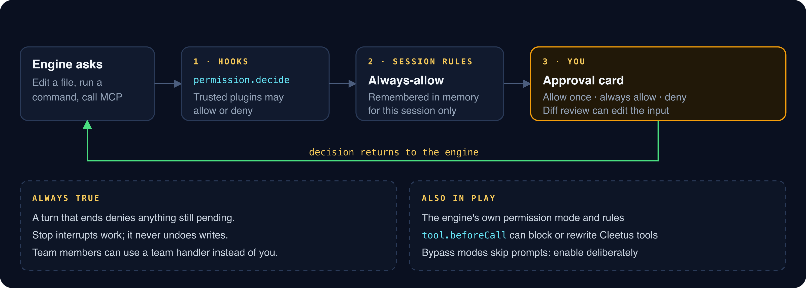
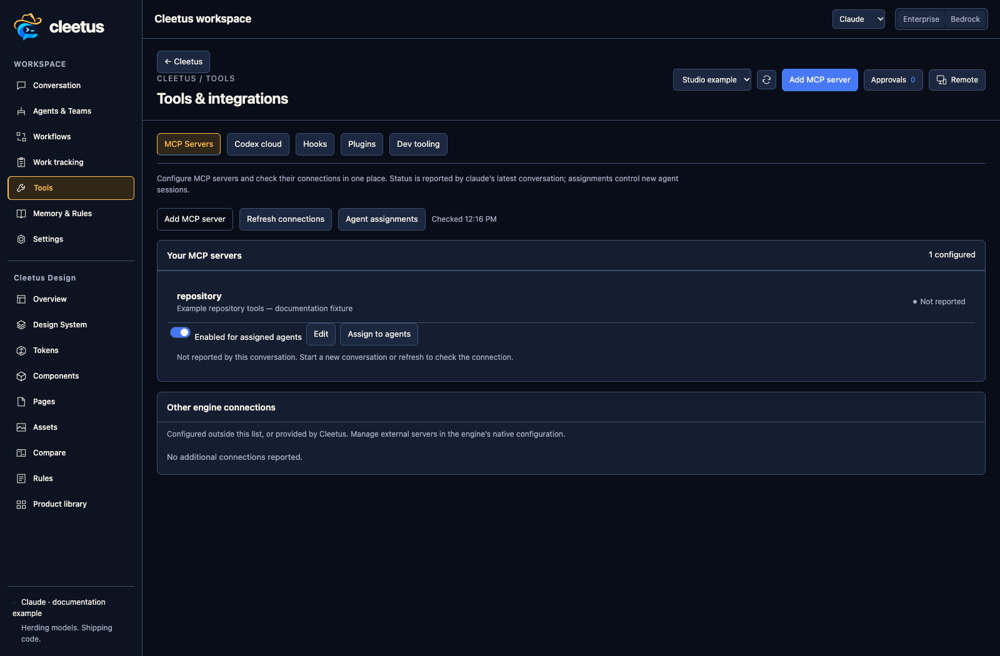
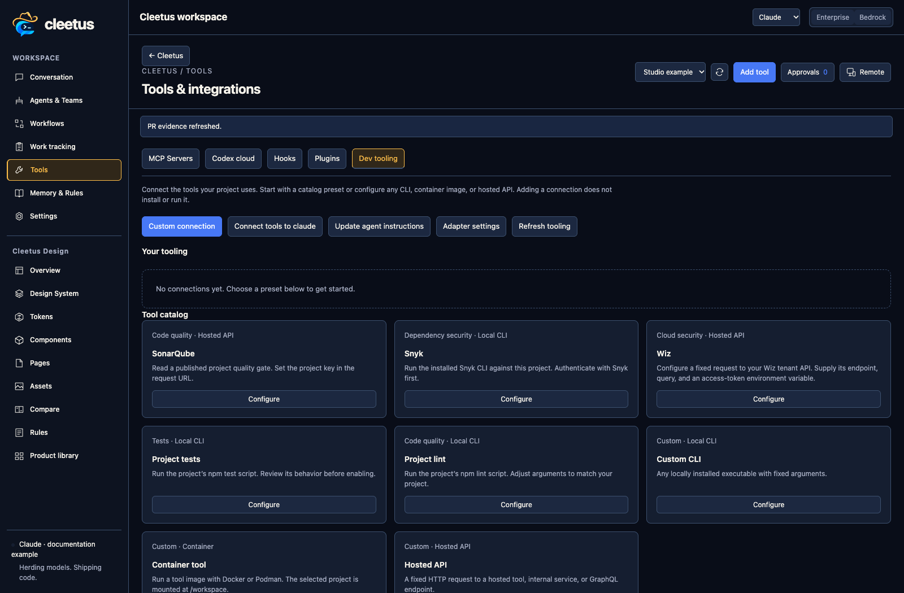

# Tools, MCP and approvals

**Release preparation:** this guide describes the proposed Cleetus IDE 0.2.0 platform. Check the [installation and release notes](INSTALL.md) for published downloads and the features in your installed build. IDE and extension releases remain independent.

_Read this guide on [cleetus.dev](https://cleetus.dev/docs/tools/)._

Agents work through tools: file edits, commands, MCP servers, Cleetus's own tools and your developer tooling. This guide covers how tools reach each agent, and how Cleetus handles requests sent through its approval and tool interfaces.

## The permission flow

When an engine sends a supported permission request to Cleetus:

1. **Hooks.** Trusted plugins' `permission.decide` hooks can allow or deny without asking you.
2. **Session rules.** If you chose **always allow** for this tool earlier in the session, it's allowed. That memory lives only for the session.
3. **You.** Otherwise a team's handler or your approval card decides: **allow once**, **always allow** or **deny**. Diff review can hand the engine an edited input.

The decision goes back to the engine. Two rules always hold: when a turn ends, anything still pending is **denied**, and **Stop** interrupts work but never rolls back files already written.

The engine's own permission mode and persistent rules also apply. Persistent allow and deny rules are the engine runtime's settings; managed policy isn't editable from Cleetus. Native rules can allow actions without a Cleetus prompt. ACP connections relay
only requests the provider sends and return one-time decisions; known bypass
flags are rejected in connection profiles. Native Claude Code keeps its own
trust, consent and tool policy. See [connection permissions](CODING_AGENTS.md#review-permissions-and-connection-changes).

## MCP servers

**Tools** lists your configured MCP servers with their status and which engines can use them. A configured connection and an engine-reported live connection are different states, and Cleetus shows both.

Assign servers **per team member** from the member's settings, so each role gets only what it needs. Assignment controls exposure; it doesn't sandbox the server, which keeps its own credentials and permissions. MCP environment fields can hold secrets, and the MCP config file is written with mode `0600`.

## Review native questions and plans

The local channel preview can show structured Claude Code questions and plan
reviews in the agent workspace and dock, after the maintainer-only local channel
setup. Questions support single choice, multiple choices and non-secret Other
answers, with nothing preselected. Sending answers or approving a plan requires
host review of that exact request. Plan approval does not approve later tool
calls or change permission rules. The Cleetus window expires after 110 seconds;
**Review in Claude Code** remains the explicit native fallback.

Visible assistant narration is separate from terminal output, hidden reasoning
and a reply linked to a channel message. Authentication, folder trust and native
channel consent stay with the provider. See [coding agent connections](CODING_AGENTS.md#visible-narration-questions-and-plan-review)
for the preview boundaries and controls.

## Workflow execution and recovery

Workflow agent steps use private sessions owned by their workflow execution.
Ordinary chat cannot queue a new prompt into a step or resume it as an
independent conversation. The run journal retains bounded failure categories and
references to service jobs or sessions actually created by that step. These
references help inspect work; they do not certify its result or accept an
arbitrary reported job ID. Select a run's step and use **Owned execution
references → Inspect** to open its recorded evidence. Session references show
recent transcript events; service-job references show limited status and a
failure category. This is read-only inspection, not a retry or provider resume,
and the project/reference association is checked.

Unreadable workflow records remain on disk and produce recovery warnings. Valid
history remains available, but new work is blocked for an affected project;
unknown record scope can block all projects until reconciled. Nothing uncertain
is replayed automatically. Inspect the warning, retained run and actual external
effects before repairing storage or approving a separate new run.

Design extraction also refuses damaged saved Design JSON before replacing its
records. A malformed session-history index is retained rather than treated as an
empty history and overwritten. These errors preserve existing bytes and explain
that recovery is required; they do not silently rebuild, delete or quarantine
data. Preserve a copy and reconcile the original record before retrying. Valid
locked Design tokens and components remain protected during extraction.

For the actual automation events and their scope, see
[workflow automation](IDE.md#optional-automation). For worker cancellation and
cleanup uncertainty, see [service recovery](SERVICE.md#recovery).

Local MCP grants are checked again while reading a request, after asynchronous
policy hooks, immediately before tool dispatch and before returning a result.
A revoked grant or lost workflow owner cannot dispatch a waiting tool. If an
already-started handler loses authority, Cleetus withholds its result; that does
not undo effects already made. Closing the Core bridge also closes its pending
connections. Authentication and permissions remain separate from chat text.

## Cleetus's own tools

Cleetus exposes its tools to Claude and Codex identically, as one local MCP server per session:

- **Team tools:** `team_roster`, `team_send`, `team_inbox`, `team_report`. See [Agent teams](TEAMS.md#handoff-tools).
- **Work tracking:** `work_tracker_*`. See [Work tracking](WORK_TRACKING.md#agent-tools).
- **Service jobs:** `cleetus_job_*`. See [Local service](SERVICE.md).
- **Peer collaboration:** `cleetus_peer_*`. See [LAN collaboration](COLLABORATION.md#let-agents-use-it).

The bridge listens on `127.0.0.1` only, rejects browser origins and requires a token that exists only while the session is open. Team capabilities are bound to each member's identity and revoked when the team is cancelled. Engines may prefix the tool names through MCP.

## Developer tooling

Start from a catalog preset (SonarQube, Snyk or a configurable Wiz API starter) or define your own: a local CLI, a container or a hosted API.

- Commands run as an executable plus an argument array, **never through a shell**. Check the executable, arguments and working directory you configure.
- Keep tokens in environment variables or secure references. The host reads them, and they're never copied into the UI.
- Configured commands don't run on their own. Reading SonarQube's latest published analysis doesn't start a new scan.
- Changing connected tools or instructions may need an engine reconnect.

To see tooling results on a pull request, have the tool report to GitHub as a check, then use [PR evidence](WORK_TRACKING.md#pull-request-evidence).

## Plugins and hooks

Cleetus plugins can add tools, slash commands, panels, hooks and even engines. They start disabled and declare permissions, but they run as ordinary Node.js in the host, so treat them as trusted local code. See [Plugins and hooks](PLUGINS.md).

[Security model](SECURITY_MODEL.md) · [Plugins and hooks](PLUGINS.md)
