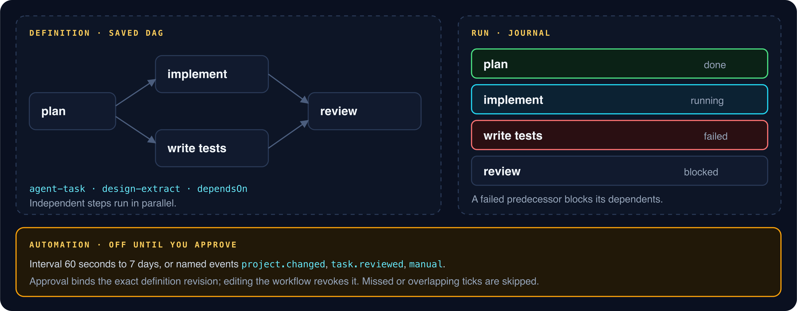
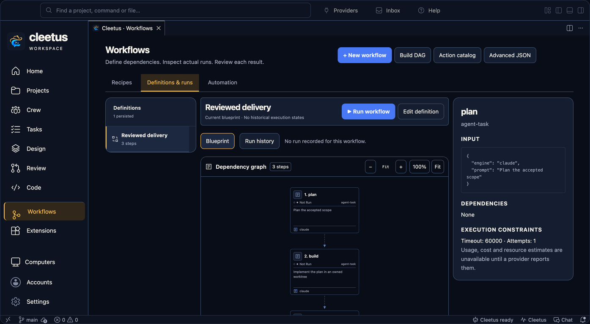

# Workflows and automation

_Read this guide on [cleetus.dev](https://cleetus.dev/docs/workflows/)._

A workflow is a saved, reusable plan: a directed acyclic graph of steps with dependencies. Each run keeps its own journal, so you can edit the definition without losing what earlier runs did. Automation can start runs on a schedule or on named events, but only after you approve that exact definition.





## Create a workflow

1. Open **Workflows** and choose a recipe: feature work, investigation, review, documentation, tests or deployment preparation.
2. Enter a bounded goal and the model and effort, then create the saved DAG. Saving never runs it.
3. Inspect the canvas. Drag to pan, **+** and **−** to zoom, **100%** for actual size or **Fit** to see it all.
4. **Run workflow** shows every step for approval. The run journal then records what actually happened, separately from the definition.

## Write steps by hand

**Advanced JSON** edits the definition directly. This is the shape a recipe produces:

```json
{
  "name": "Settings refactor",
  "steps": [
    {
      "id": "plan",
      "action": "agent-task",
      "dependsOn": [],
      "timeoutMs": 1800000,
      "input": {
        "engine": "claude",
        "model": "",
        "effort": "high",
        "title": "Planner",
        "prompt": "Plan the settings refactor…"
      }
    },
    {
      "id": "implement",
      "action": "agent-task",
      "dependsOn": ["plan"],
      "input": { "engine": "codex", "title": "Implementer", "prompt": "…" }
    },
    {
      "id": "tests",
      "action": "agent-task",
      "dependsOn": ["plan"],
      "input": { "engine": "codex", "title": "Tester", "prompt": "…" }
    },
    {
      "id": "review",
      "action": "agent-task",
      "dependsOn": ["implement", "tests"],
      "input": { "engine": "claude", "title": "Reviewer", "prompt": "…" }
    }
  ]
}
```

| Field         | Rules                                                                                                                                                                      |
| ------------- | -------------------------------------------------------------------------------------------------------------------------------------------------------------------------- |
| `id`          | Unique, letters, digits, `_` and `-`, up to 64 characters                                                                                                                  |
| `action`      | An allowlisted action: `agent-task` for an engine request, `design-extract` for a [Design extraction](DESIGN.md)                                                       |
| `dependsOn`   | Distinct IDs of existing steps. Cycles are rejected when you save                                                                                                          |
| `input`       | Up to 16 KiB. For `agent-task`: `engine`, optional `backend`, `model` (empty for the engine default), `effort`, `title` and a required `prompt` of up to 12,000 characters |
| `timeoutMs`   | 10 ms to 1 hour; defaults to 60 seconds. Recipes set 30 minutes for agent steps                                                                                            |
| `maxAttempts` | 1 to 3, and above 1 only for actions marked retry-safe                                                                                                                     |

## How runs execute

- **Independent steps run in parallel**, and dependents wait for their predecessors.
- **Each agent step starts its own session** in the project and receives its predecessors' results as context, to verify rather than trust.
- **A failed predecessor blocks its dependents.** Nothing downstream runs on a broken result.
- **Side effects aren't retried.** Agent and Design actions aren't retry-safe, so they run once.
- **Cancellation is a request.** Work that hasn't settled stays uncertain until you check it.
- **Interrupted runs aren't replayed** after a restart.
- **Editing a definition preserves earlier runs** and their journals.

## Automation

**Workflows → Automation → + Add automation** attaches a trigger to a workflow:

| Trigger           | Details                                 |
| ----------------- | --------------------------------------- |
| Interval          | Every 60 seconds to 7 days              |
| `project.changed` | A named host event, not a file watcher  |
| `task.reviewed`   | Fires when a task review is recorded    |
| `manual`          | Emit it yourself with **Emit an event** |

New automation starts **disabled**. Enabling or changing it needs your approval of the **exact definition revision and trigger**, so editing the workflow later revokes that approval until you approve again.

- Missed and overlapping intervals are skipped, never queued up.
- A failed or uncertain dispatch stops future automation for that workflow until you review it.
- Reusing an event ID returns the receipts it already produced; **New event ID** requests a distinct delivery.
- **Emit an event** needs approval too.

Inspect dispatch history next to the run it started. Disable or remove an automation to stop future dispatches.

## Workflows, recipes or teams?

| Use                    | When                                                                                      |
| ---------------------- | ----------------------------------------------------------------------------------------- |
| A conversation         | One bounded task                                                                          |
| A conversation recipe  | A reusable prompt where one engine decides how to delegate                                |
| A [team](TEAMS.md) | Explicit roles, handoffs and reports scheduled by Cleetus                                 |
| A workflow             | A repeatable multi-step plan with dependencies, a journal per run and optional automation |

[Tasks](TASKS.md) · [Agent teams](TEAMS.md) · [Design](DESIGN.md)

## Compose deterministic steps, agents and human review

Choose **Build DAG** to add nodes, select an action from the live catalog, edit
its JSON input and list dependency IDs. Inspect each action's owner, declared
kind, contracts and retry declaration. **Advanced JSON** remains available.
Saving is separate from execution and never starts a provider.

The built-in `design-extract` uses the existing isolated Design service;
`agent-task` creates an owned Core session with existing provider/tool approvals;
`human-review` requests a separate host review of displayed dependency evidence.
A human-review node does not accept task work, publish or authorize deployment.
Missing or declined approval fails that node and blocks dependents.

Enabled trusted plugins can add owner-namespaced actions to the same runtime and
canvas. The saved node pins the owner's version, entry identity and contract
revision. A missing or changed action must be reviewed and saved again before a
new dispatch. An admitted run never substitutes a reloaded plugin handler.

Typed outputs can supply top-level inputs through explicit bindings:

```json
{
  "id": "agent",
  "action": "agent-task",
  "dependsOn": ["inspect"],
  "input": {"engine":"codex", "prompt":"Verify the recorded source evidence."},
  "inputFrom": {"title":{"step":"inspect", "path":["name"]}}
}
```

Here `inspect` must be a declared dependency and its successful result must have
`outputs.name`. Missing output paths fail before the dependent action executes.
Agent dependency reports remain untrusted evidence, not instructions or proof.
No event-payload interpolation or expression evaluator is introduced.

An `agent-task` may also carry `catalogSelection` with the exact current
`version`, `source`, `revision`, `definitionHash` and `roleID` from the agent
library. Raw role-instruction overrides are rejected. Dispatch refreshes and
resolves that reference, then requests a separate complete host review of the
role instructions, task and execution choices before creating the owned session.
A changed catalog or account fails the step; reload and review its reference
before a separately approved run. The workflow definition retains the reference,
not a copy of the resolved role instructions.

Definitions with plugin revision pins or typed bindings use storage version 2.
The first such save preserves the version-1 definition bytes in a
revision-named backup. Legacy-only definitions stay version 1 until that feature
is used. Version-1 clients refuse newer storage; use a compatible client, and
review the preserved backup before any deliberate rollback. Interrupted runs
are never replayed by upgrading or restoring storage.
