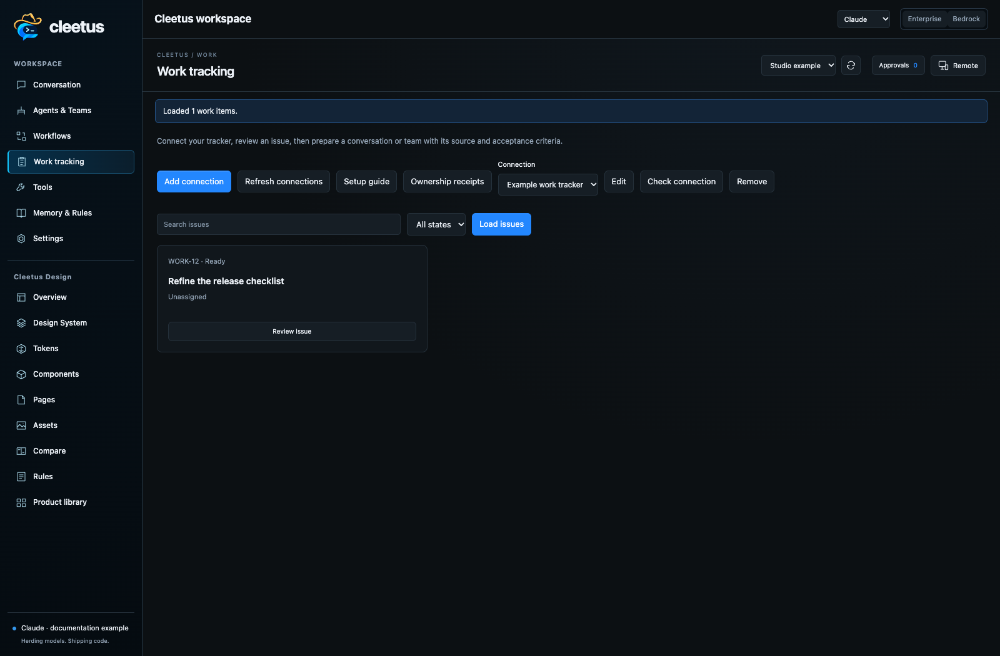
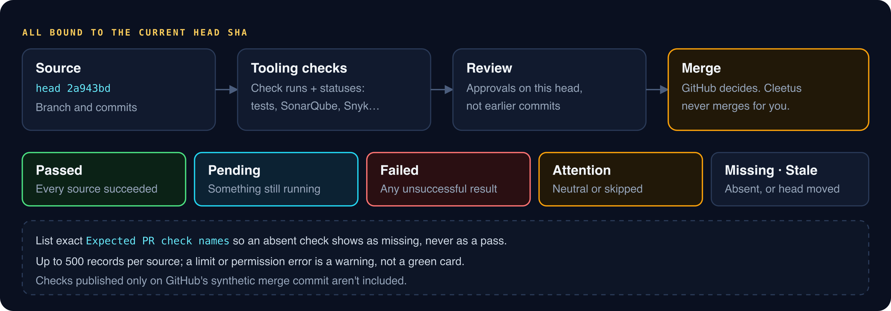
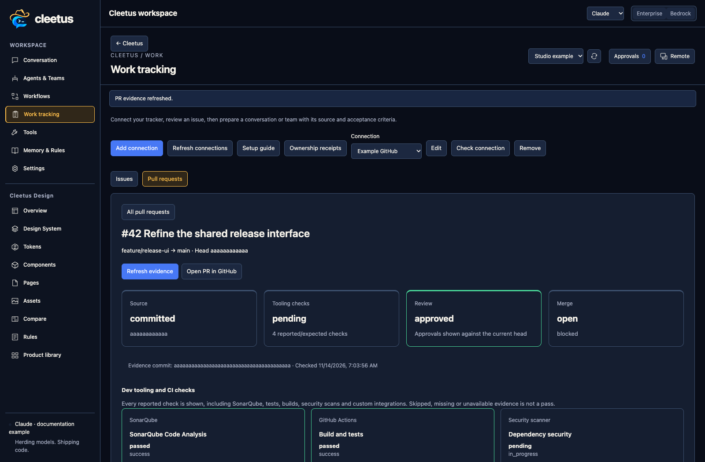

# Work tracking and PR evidence

_Read this guide on [cleetus.dev](https://cleetus.dev/docs/work-tracking/)._

Connect GitHub Issues, Jira or your own tracker, turn an issue into a task brief for a conversation or team, and see a pull request's checks, reviews and merge evidence for its exact head commit. Agents get the same access through engine-neutral tools, including atomic, fenced claims when your tracker supports them.



## Connect a tracker

1. Open **Work tracking** (or **Cleetus: Open Work Tracking**) and choose **Add connection**: GitHub Issues, Jira Cloud, Jira Data Center or Custom REST tracker.
2. Enter a name and the HTTPS API base URL. Use `https://api.github.com` for GitHub.com, or your GitHub Enterprise API root such as `https://your-host/api/v3`.
3. Set `owner/repository` for GitHub or the project key for Jira. Jira Cloud also needs your account email. Map an acceptance-criteria field by its ID, such as `customfield_12345`.
4. Enter a token, or the name of an environment variable that holds it.
5. **Check connection**, then **Load issues**. GitHub search takes issue-search syntax scoped to the repository; Jira takes a JQL condition such as `assignee = currentUser()`, without `ORDER BY`.

Tokens live in the secure credential store. Your profile's `work-tracking.json` holds only metadata and credential references, and an environment reference wins over a typed token. Jira Cloud uses email plus API token; Jira Data Center and GitHub use bearer tokens. There's no OAuth flow yet, and TLS validation is never disabled.

## From issue to work

**Review issue** shows the title, source, status, description and mapped acceptance criteria. **Draft in Conversation** inserts a task brief without sending it, and **Prepare team** opens team setup with the issue filled in.

The brief carries the connection ID, work-item ID, source URL and ownership context. Issue content is treated as **untrusted evidence**, not instructions, and long fields are marked truncated. Agents should call `work_tracker_get` for the full issue before implementing.

**Create issue** and **Post comment** publish only when you click submit. Writes aren't retried automatically, so after a timeout check the tracker before trying again.

## Pull request evidence



Choose a GitHub connection, then **Pull requests → View PR flow**. Each card comes from GitHub check runs and commit statuses for the PR's **current head SHA**: tests, builds, SonarQube, Snyk, anything that reports to GitHub.



| State              | Means                                                                                    |
| ------------------ | ---------------------------------------------------------------------------------------- |
| Passed             | Every collected check succeeded and every evidence source completed                      |
| Pending            | At least one check is queued or running                                                  |
| Failed             | At least one check ended unsuccessfully                                                  |
| Attention          | Some results are neutral or skipped; they're never shown as passes                       |
| Unknown or missing | No usable evidence, an unavailable source, incomplete paging or an absent expected check |
| Stale              | The head moved while evidence was loading. Refresh before relying on it                  |

Add **Expected PR check names**, one exact name per line, so a check that never reported shows as missing. Reviews separate approvals on the current head from approvals on earlier commits. Branch protection and rulesets **aren't verified**, and Cleetus has no merge button: green cards are not permission to merge. Collection stops at 500 records per source with a warning, and checks published only on GitHub's synthetic merge commit aren't included.

## Agent tools

| Tool                         | What it does                                              |
| ---------------------------- | --------------------------------------------------------- |
| `work_tracker_connections`   | List connections, without credentials                     |
| `work_tracker_list`          | Search and page through work items                        |
| `work_tracker_get`           | Read an item with its acceptance and ownership context    |
| `work_tracker_pull_requests` | List the repository's PRs                                 |
| `work_tracker_pr_checks`     | Read head checks, review and merge evidence; never merges |
| `work_tracker_claim`         | Take an atomic claim; proceed only on success             |
| `work_tracker_renew`         | Renew a claim with its saved fencing generation           |
| `work_tracker_release`       | Release a claim with its saved fencing generation         |

## Claims and fencing

Claims are leases, not assignee labels. They need a tracker with an atomic ownership contract, configured as a custom REST adapter; GitHub and Jira assignment isn't treated as a lease. Turn on **Allow agent ownership operations** to enable them.

- **Claims belong to the Cleetus session**, not to an ID the agent supplies. Another local session can't renew or release them.
- **Local reservation first.** Concurrent claims are reserved locally before the network call, and your server arbitrates between machines.
- **Fencing generations.** The generation from each claim response is saved and sent with every renewal and release.
- **No automatic heartbeat.** Agents must renew before expiry.
- **Uncertain claims stay blocked.** If the network fails mid-claim, the uncertain receipt blocks a blind reclaim. **Ownership receipts → Reconcile locally** is the human recovery path: check the remote lease, then forget the local record. Forgetting doesn't release remote work.

Reconciliation confirmation is bound to the exact receipt you reviewed. If its
owner or state changes while the dialog is open, refresh and inspect the current
record. A late response from an older reconciled operation cannot replace a
newer claim. This does not undo any write already accepted by the remote tracker.

### Valid ownership generations

In Beta 7, a fencing generation must be a safe integer or a nonblank string of at
most 500 characters. Send large numeric tokens as strings so JSON number rounding
cannot change ownership identity. Cleetus preserves opaque strings exactly.
Overflow, fractional or unsafe numbers, blank strings and explicit null values
cannot become an owned receipt. If an unusable response follows a write, the
receipt stays uncertain; inspect the remote tracker before recovery.

An existing receipt with an unusable generation cannot renew or release work.
Cleetus rejects it before a network call and preserves the stored bytes for
inspection. Use explicit reconciliation after checking the remote lease; editing
or reloading the local file is not a safe ownership transfer. A renewal that omits
a replacement generation can retain the prior usable value, but explicit null
is rejected.

### Bounded responses and ownership changes

In Beta 6, tracker responses are limited to 3 MiB of UTF-8 data while they are
read. Over-limit responses stop early; narrow the query instead of loading an
unbounded result. An unreadable response after a write can mean the service
accepted it. Inspect the tracker before retrying. Claim operations retain an
uncertain receipt so they cannot silently run again.

Connection edits recheck ownership receipts when the edit is saved, including
when another agent acquired a claim while credentials were being stored. Changing
the endpoint or disabling ownership operations waits until receipts are resolved.
Renaming a connection keeps its existing claims.

## Custom REST adapter

Custom trackers are configuration, not code. Paths are relative to your API root and dotted paths address nested JSON:

```json
{
  "listPath": "/api/v1/work",
  "readPath": "/api/v1/work/{id}",
  "itemsPath": "items",
  "nextCursorPath": "nextCursor",
  "idField": "id",
  "titleField": "title",
  "descriptionField": "description",
  "statusField": "status",
  "criteriaField": "criteria",
  "contextFields": ["goalId", "dependencies", "owner", "lease"],
  "queryParam": "search",
  "cursorParam": "cursor",
  "limitParam": "limit",
  "auth": "bearer",
  "claimPath": "/api/v1/work/{id}/claim",
  "renewPath": "/api/v1/work/{id}/renew",
  "releasePath": "/api/v1/work/{id}/release",
  "claimDefaults": { "ttl": 60000 },
  "generationPath": "lease.generation",
  "generationField": "generation",
  "commentPath": "/api/v1/work/{id}/comments",
  "commentBodyField": "message"
}
```

Lists use GET; creating, commenting, claiming, renewing and releasing use POST JSON. Ownership paths must contain `{id}`, and a claim response must expose a fencing generation as a string or number. Use `"auth": "header"` with `"tokenHeader": "X-API-Key"` for a custom header. Leave a write path empty and that action stays unavailable. Give the adapter a scoped worker credential; it never bypasses your server's admission or scheduling.

Tracker and PR requests run in the [local service](SERVICE.md), which gets credentials through a narrow broker and never writes them into job records.

List calls use GET with the configured query/state/cursor/limit parameters. Creation, comments, claims, renewal and release use POST JSON. Ownership paths must contain `{id}`. A claim response must expose a fencing generation/token as a nonblank bounded string or safe integer; subsequent requests send the saved value through `generationField`. The adapter does not guess a scheduler or worker protocol from a URL.

## Service execution

Tracker requests and PR evidence aggregation run in the [local Cleetus service](SERVICE.md). The extension brokers SecretStorage access over the private process channel. Environment credentials must be available when the service starts. The service preserves provider authorization, session-bound ownership, fencing generations, and uncertain-write handling; a process restart does not grant permission to repeat a claim or write.

## Storage and limitations

`work-tracking.json` in your Cleetus profile stores connection metadata; `work-claims.json` stores local session-bound ownership receipts. Tokens remain in the VS Code secure store or environment. Removing configuration does not change remote issues. Do not copy credential references between installations expecting a transferred login.

Provider HTTP failures, rate limits and ownership conflicts remain visible. Only authenticated, permitted records are available. Custom APIs with OAuth-only login, non-REST transports, different write verbs, or a different ownership protocol need an additional adapter capability. Configure only endpoints you trust; connected issue data can include internal project information and becomes engine context when you draft/send work.

API references: [GitHub check runs](https://docs.github.com/en/rest/checks/runs), [GitHub pull requests](https://docs.github.com/en/rest/pulls/pulls), [GitHub Issues REST](https://docs.github.com/en/rest/issues/issues), [Jira Cloud enhanced JQL search](https://developer.atlassian.com/cloud/jira/platform/rest/v3/api-group-issue-search/).

[Tasks](TASKS.md) · [Review & Ship](REVIEW.md) · [Local service](SERVICE.md)
